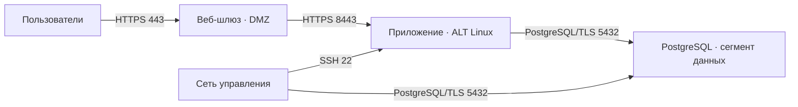

# Учебный кейс «Сервис заявок»

Все организации, образцы данных и результаты проверок вымышлены. Материалы отражают один снимок конфигурации учебного объекта. Анализ выполняют по таблицам и приведённым фрагментам.

## Паспорт объекта · Д1

Частное ООО «Учебный сервис» принимает заявки на услуги. Клиент заполняет имя, телефон и электронную почту. Сервис возвращает идентификатор и статус. Сотрудник обрабатывает заявки через внутренний интерфейс приложения. PostgreSQL хранит заявки 1200 клиентов, которые не являются сотрудниками оператора. По легенде это иные категории ПДн. Система не содержит специальных или биометрических данных. Признаки ГИС и объекта КИИ в паспорте отсутствуют.

Преподаватель сначала выдаёт паспорт без сведения о типе угроз. После фиксации недостающего входа выдаёт **вводную Д1‑У**. Оператор по условиям легенды определил третий тип актуальных угроз по п. 7 требований № 1119. Студент использует эту вводную для определения УЗ и отдельно разбирает один конкретный сценарий угрозы, например доступ из пользовательской зоны в сегмент БД.

Целевая схема показывает начало соединений. Сотрудник работает с заявками через веб-приложение под отдельной учётной записью. Межсетевой экран фильтрует трафик между зонами. Журналы и резервные копии входят в границы анализа как связанные места хранения сведений. Проверка TLS внешнего канала относится к потоку **F1**. По внутренним каналам F2 и F3 TLS задан целевой схемой.

## Публичный API · Д2

| Наблюдение | Целевое состояние | Фактическое состояние |
|---|---|---|
| Д2.1. Успешный ответ на создание заявки | HTTP 201. Поля `request_id`, `status` | HTTP 201. Поля `request_id`, `status`, `phone`, `email` |
| Д2.2. Запись о создании | Время, идентификатор запроса, действие и код результата | Те же поля и тело заявки с именем и контактами |
| Д2.3. Эталон функции | Заявка сохраняется. Клиент получает идентификатор и статус | Создание заявки и запись в БД подтверждены для учебного примера |

## Сетевой узел приложения · Д3

| Наблюдение | Результат |
|---|---|
| Д3.1. Слушающие службы | SSH слушает TCP/22 на всех IPv4-интерфейсах. API слушает TCP/8443 на интерфейсе сегмента приложений |
| Д3.2. SSH по зонам | Сеть управления — доступно. Пользовательская зона — отказ межсетевого экрана |
| Д3.3. Учебный SCA | Правило проверки прав файла вернуло Failed. Оно ожидало `/etc/ssh/sshd_config`, файла по этому пути нет |
| Д3.4. Фактическая конфигурация | Рабочий SSH-файл находится по адресу `/etc/openssh/sshd_config`. Владелец root, группа root, права 0600 |

Критерий лабораторного примера — SSH только из сети управления. Критерий для файла — права 0600 и владелец root:root.

## База данных · Д4

Роль `web_app` создаёт заявки. По принятому проектному решению она может добавить запись и прочитать её идентификатор и статус для формирования ответа. Служебные выборки операторов идут под отдельной ролью. Роль `dba` предназначена для администрирования из сети управления.

| ID | Наблюдение | Что известно |
|---|---|---|
| Д4.1 | Поток F3 с сервера приложения к БД | TCP проходит. Установлен сеанс TLS, роль `web_app` допущена |
| Д4.2 | Поток F6 из пользовательской зоны к БД | TCP проходит. Сервер БД отклонил допуск для этого источника |
| Д4.3 | Объектные права `web_app` | Роль имеет INSERT на заявки и SELECT на всю таблицу, включая контакты |
| Д4.4 | Поток F5 из сети управления | Доступность TCP и аутентификация роли `dba` подтверждены |

## Потоки и TLS · Д5

| ID | Источник | Назначение | Цель | Наблюдение |
|---|---|---|---|---|
| F1 | Пользователи | Веб-шлюз, TCP/443 | Разрешить подключение с валидным TLS | TCP проходит, проверка имени TLS завершается отказом |
| F2 | Веб-шлюз | Приложение, TCP/8443 | Разрешить HTTPS | HTTPS проходит |
| F3 | Приложение | PostgreSQL, TCP/5432 | Разрешить соединение по TLS | TLS проходит |
| F4 | Сеть управления | Узел приложения, TCP/22 | Разрешить SSH | SSH доступен |
| F5 | Сеть управления | PostgreSQL, TCP/5432 | Разрешить допуск роли DBA по TLS | Подключение проходит |
| F6 | Пользователи | PostgreSQL, TCP/5432 | Запретить прямой TCP-доступ | TCP проходит, допуск БД отклонён |
| F7 | Пользователи | Приложение, TCP/8443 | Запретить обход шлюза | TCP проходит, HTTPS доступен |
| F8 | Пользователи | Узел приложения, TCP/22 | Запретить | Межсетевой экран блокирует |

**Д5‑TLS.** Для F1 ожидается имя `zayavki.example`. В SAN предъявленного сертификата указан только `old.example`. Цепочка доверия и срок действия по учебному выводу корректны. Д2 снят на внутренней точке наблюдения приложения. Он описывает поведение API и не подтверждает доступность F1.

## Межсетевой экран и документы · Д6

| ID | Вход | Исходные сведения |
|---|---|---|
| Д6.1 | Конфигурация | Межсетевой экран «Учебный фильтр» версии 3.2. Запрещающее правило для F6 выключено. Ниже есть разрешающее правило R90 |
| Д6.2 | Журнал | Событие E106 относится к потоку F6, действие allow, совпавшее правило R90 |
| Д6.3 | Документ | Карточка поставщика относится к 3.1. Номер официального сертификата и материалы о распространении его области на 3.2 не предоставлены |
| Д6.4 | Допустимый поток | Поток F3 из сегмента приложения должен сохраниться после изменения правила |

Цели курса предусматривают учебный вывод по выборке и сбор доказательств для решения о повторной проверке.
