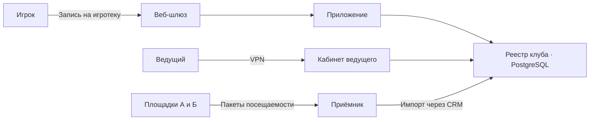

# Анализ безопасности автоматизированных систем
## Клуб настольных игр «В гостях у троллей»

Подготовил Ижутов Михаил Алексеевич.

Клуб «В гостях у троллей» — общий объект трёх тем по дисциплине «Анализ безопасности автоматизированных систем» (АБАС). В учебной модели клуб проводит игротеки, принимает онлайн-заявки, даёт ведущим доступ к спискам своих мероприятий и ведёт общий реестр посещений. Архитектура, площадки, объём данных, роли и наблюдения заданы для практических занятий.

**Цель** — научиться исследовать безопасность автоматизированной системы от описания процесса и выбора применимых требований до проверки мер по техническим наблюдениям и подготовки заключения. **Предмет анализа** — защита сетевых соединений, доступа к данным, обработки событий и хранения записей.

## Три темы дисциплины

| Тема | Почему выбрана | Результат студента |
|---|---|---|
| [1. Анализ защищённости онлайн-записи на игротеки](laba2.md) | Публичная форма связывает интернет, веб-шлюз, сервер приложения и БД. В этом процессе видны риски избыточного раскрытия данных и ошибок разделения сети | Схема границ ИСПДн, обоснование УЗ и протокол проверки веб-ответов, журнала, TLS и доступа к БД |
| [2. Анализ защищённости удалённого доступа ведущих](../2%20%D1%82%D0%B5%D0%BC%D0%B0/laba2.md) | Ведущему нужен список назначенной игротеки. Требуется проверить допуск устройства, сетевую достижимость, доступ к строкам списка и отзыв прав при смене назначения | Матрица «роль → мероприятие → действие» и вывод по VPN, MFA, сетевым правилам и журналам отзыва |
| [3. Анализ защищённости обмена списками между площадками](../3%20%D1%82%D0%B5%D0%BC%D0%B0/laba2.md) | Отметки о посещении попадают в центральный реестр. Защита зависит от прав отправителя, целостности пакета и корректной обработки повторной доставки | Матрица сетевых потоков и вывод по mTLS, полномочиям отправителя, импорту и журналированию |

## Учебный паспорт автоматизированной системы

Частный оператор в России ведёт ИСПДн клуба. В реестре 1 200 уникальных совершеннолетних участников, которые не являются работниками оператора. В кейсе обрабатываются иные категории ПДн, специальные и биометрические данные отсутствуют. Веб-шлюз отделяет внешний сегмент от приложения. База PostgreSQL находится в сегменте данных. Ведущие работают с кабинетом через VPN. Шлюзы учебных площадок А и Б передают отметки в центральный реестр через выделенный приёмник. Отдельно анализируются управление и журналы.

Для расчёта уровня защищённости (УЗ) преподаватель выдаёт Д1‑У после того, как группа определит, каких сведений ей не хватает. В основном варианте Д1‑У задаёт третий тип актуальных угроз. Для этого варианта установите УЗ по подп. «б» п. 12 требований ПП РФ № 1119. Экзаменационные данные в темах 2 и 3 меняют условия задачи.

## Процессы, данные и доступ

| Процесс и цель | Данные | Кому и для чего предоставляется доступ | Доказательство для анализа |
|---|---|---|---|
| Регистрация и связь с игроком по заявке | Имя, мероприятие, контакт, ID и статус заявки. В учебной форме есть телефон и почта. Студент обосновывает необходимость каждого поля | Приложение принимает заявку. Игроку возвращаются ID и статус. Произвольный сетевой клиент не получает контакты | Описание формы, выписка из HTTP-ответа, запись журнала, матрица потоков и ролей |
| Подготовка и проведение игротеки | Записи соответствующего мероприятия. Контакт доступен ведущему, если нужен для связи по этому мероприятию | Ведущему доступен список назначенной игротеки. Базовая роль даёт доступ к собственному расписанию | Выписка списка, назначение на мероприятие и записи о входе и отзыве роли |
| Учёт посещения в центральном реестре | ID участника, ID мероприятия, отметка посещения. В технических записях используются служебные идентификаторы | Шлюз площадки отправляет данные по своим мероприятиям. Приёмник определяет очередь отправителя и возвращает квитанцию | Матрица потоков, выписка обмена, хеш и ID пакета, запись об импорте, журнал |
| Обработка по выбранному правовому основанию | Цель, состав данных, основание, срок обработки и документальное подтверждение | Оператор определяет и документирует параметры процесса. Согласие фиксируется, если именно оно служит основанием | Выписка из политики и локального регламента, пример отдельного согласия при его применении или документ, подтверждающий иное основание |

## Нормативные и правовые основания

Дата сверки источников — 26 ноября 2026 года. Отдельные нормы и методические источники привязаны к проверкам в реестрах [темы 1](norms.md), [темы 2](../2%20%D1%82%D0%B5%D0%BC%D0%B0/norms.md) и [темы 3](../3%20%D1%82%D0%B5%D0%BC%D0%B0/norms.md).

| Назначение | Документ и область применения | Что проверяем в системе клуба |
|---|---|---|
| Основные правила обработки ПДн | **152‑ФЗ**, ст. 3, 5, 6, 9, 18.1, 19 и 22. Область ИСПДн, целевое ограничение, правовое основание, меры оператора, безопасность и уведомление Роскомнадзора с учётом исключений. [Текст закона](https://www.consultant.ru/document/cons_doc_LAW_61801/) | Паспорт и цель процесса, перечень полей и срок хранения, доступ ведущего, состав журналов и документ об основании. Если применяется согласие, проверяем его отдельное оформление по ст. 9 |
| Общие обязанности по защите информации | **149‑ФЗ**, ст. 16. Общие требования к защите и предупреждению неправомерных действий. [Текст закона](https://www.consultant.ru/document/cons_doc_LAW_61798/) | Границы доступа к приложению и БД, регистрация событий и порядок реагирования |
| Определение уровня защищённости ИСПДн | **ПП РФ № 1119**, пп. 5–12. Тип актуальных угроз, категория ПДн, число и статус субъектов. [Текст требований](https://www.consultant.ru/document/cons_doc_LAW_137356/) | Обоснование УЗ с исходными параметрами и ссылкой на конкретный подпункт |
| Требования к мерам защиты | **Приказ ФСТЭК России № 21**. Состав мер выбирают с учётом УЗ, угроз и архитектуры. [Текст приказа](https://www.consultant.ru/document/cons_doc_LAW_146520/) | Идентификацию, доступ, настройку системы, регистрацию, целостность и защиту взаимодействия. Конкретные допустимые потоки и права берём из схемы и Л1 |
| Оформление уведомления | **Приказ Роскомнадзора № 180**. Формы уведомлений используют, если обязанность возникает по ст. 22 152‑ФЗ. [Текст приказа](https://minjust.consultant.ru/documents/33819) | Соответствие полей уведомления описанным целям, категориям данных и субъектов |
| Внутренняя проверка и аудит | **ГОСТ Р 56045‑2021** как методический источник. Общую структуру аудита уточняют применительно к ИСПДн, а технические критерии фиксируют в программе проверки. [Карточка стандарта](https://protect.gost.ru/gost/details/897416ef-4b50-4c57-aa81-6df5140e7e74) | Область и критерии, выборку, наблюдения, выводы и план повторной проверки |
| Аттестация и сертификация | **Приказ ФСТЭК № 77** в действующей редакции рассматривают при наличии основания для аттестации в его области применения. **Приказ ФСТЭК № 55** относится к сертификации средств защиты. [№ 77](https://base.garant.ru/401599204/) · [Изменения № 60](https://publication.pravo.gov.ru/document/0001202606250029) · [№ 55](https://base.garant.ru/483425739/) | Обоснование применимости процедуры и сверку версии, конфигурации и документа на СЗИ, если требуется подтверждение характеристик средства |
| Криптографическая защита | **Приказ ФСБ России № 378** учитывают при применении СКЗИ для выполнения требований к защите ПДн. Проверку параметров TLS проводят по техническим документам и локальным критериям. [Текст приказа](https://base.garant.ru/70727118/) | Обоснованность выбора и документы на используемое средство. Для TLS — доверие, имя узла или идентичность стороны и ограничения доступа |
| Гражданско-правовой блок для платных игр | При оказании платных услуг применимость проверяют по **главе 39 ГК РФ** и **Закону РФ № 2300‑1**, в частности ст. 8–10 об информации для потребителя. Для обработки ПДн основание определяют отдельно по ст. 6 152‑ФЗ. [ГК РФ](https://www.consultant.ru/document/cons_doc_LAW_9027/dcddd3f582c1637141ba49e1333bff73186d6301/) · [Закон о защите прав потребителей](https://www.consultant.ru/document/cons_doc_LAW_305/) | При платном сценарии дополнительно изучают условия услуги, сведения для игрока и набор ПДн, необходимый для оформления. В рамках трёх работ проверяется регистрация без платёжной функции |

Федеральные законы задают режим обработки и защиты. ПП № 1119 определяет, как выбрать УЗ, а приказ № 21 — набор мер для анализа. Локальный регламент Л1, схема сети и матрица ролей задают критерии наблюдений в клубе. Методические документы, ГОСТ и технические стандарты помогают подготовить процедуру и оценить доказательства. Для ГИС и КИИ сначала проверяют признаки специальных режимов в паспорте. Уровень защищённости ИСПДн и категорирование объектов КИИ рассчитывают по разным основаниям.

## Общий порядок практической работы

1. Описать процесс клуба, категорию данных и маршрут через компоненты автоматизированной системы.
2. Определить применимые нормы и зафиксировать локальные критерии, по которым можно сделать вывод.
3. Сопоставить каждое требование с выпиской из роли, правила фильтрации, ответа сервиса или журнала.
4. Описать обнаруженное отклонение, его последствие для клуба и результат, который подтвердит исправление.

В каждой теме есть краткие лекции в Marp Markdown, практическая методика с учебными материалами, экзамен, задания для докладов и мини-мастер-классов и десять слайдов для представления темы.

## Сквозное экзаменационное задание по АБАС

Перед очередной игротекой оператор проверяет весь путь данных — от заявки до отметки в реестре. Преподаватель выдаёт три выписки из учебных материалов.

| Участок | Исходные сведения | Вопрос к студенту |
|---|---|---|
| Онлайн-запись | В [кейсе темы 1](case.md) поток F6 допускается правилом R90, журнал фиксирует E106 | Какое сетевое требование нарушено? Что можно заключить по этим данным о доступности порта и о доступе к заявкам? |
| Кабинет ведущего | В [кейсе темы 2](../2%20%D1%82%D0%B5%D0%BC%D0%B0/case.md) результат P33 содержит записи другой игротеки | Какое ограничение роли нарушено? Какие две выборки покажут, что после исправления ведущий получает данные только своего мероприятия? |
| Обмен площадок | В [кейсе темы 3](../3%20%D1%82%D0%B5%D0%BC%D0%B0/case.md) в P42 повторно импортируется пакет А/42 | Какие источники показывают повторное изменение реестра? Как проверить, что повторная доставка больше не создаёт записей? |

Подготовьте единое заключение. Укажите границы ИСПДн и нормативное основание для определения УЗ. Для каждого из трёх участков запишите нарушенный критерий, наблюдение, возможное последствие и ожидаемый результат повторной проверки. Свяжите хотя бы одну техническую проверку с требованием 152‑ФЗ или приказа № 21. Расставьте приоритеты исправления с учётом возможных последствий для клуба и участников.

**Оценивание из 20 баллов.** За границы и обоснование УЗ — 4. За каждый разобранный участок — до 4 баллов, по одному за критерий, доказательство, последствие и план проверки. За нормативную привязку и обоснование приоритетов — по 2 балла.
