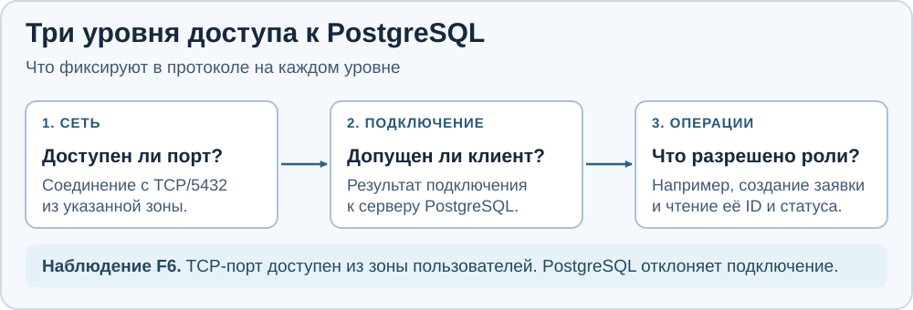
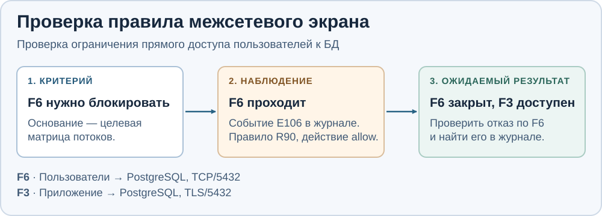

# Лекция по теме 1

Анализ защищённости онлайн-записи на игротеки клуба «В гостях у троллей».

[Лабораторная работа](laba2.md) · [Практика](practice.md) · [Обоснование по нормативам](norms.md#обоснование-по-блокам)

## Т1. Границы ИСПДн и определение УЗ

**Что нужно знать.** Студент знает, какие узлы, каналы и места хранения относятся к ИСПДн. Он понимает, как категория данных, количество и статус субъектов и тип угроз используются для определения УЗ.

Игрок отправляет имя, телефон и почту через HTTPS. Шлюз передаёт запрос приложению, приложение записывает данные в PostgreSQL. В область обследования входят также сеть управления, журналы и резервные копии, поскольку они дают доступ к компонентам или содержат сведения о заявках.

Для определения уровня защищённости нужны категория данных, количество и статус субъектов и тип актуальных угроз. В Д1 известны первые параметры. После получения Д1‑У студент сопоставляет все условия с постановлением № 1119 и указывает подпункт, по которому сделан вывод. Отдельный сценарий угрозы описывают через источник, затронутый актив и возможное последствие. Для прямого доступа пользователей к БД проверяемый критерий задаёт строка F6. [Слайды Т1](lectures/01-scope.marp.md) · [Нормативные источники Н1, Н2 и М1](norms.md)

## Т2. Анализ безопасности веб-приложения

**Что нужно знать.** Студент знает, для чего API возвращает идентификатор и статус, чем ответ отличается от диагностической записи и как избыточное копирование контактов увеличивает область хранения ПДн.

При создании заявки у запроса, ответа и журнала разные задачи. Запрос содержит сведения для обработки заявки. Публичный ответ подтверждает её создание и возвращает идентификатор и статус. Журнал связывает операцию с запросом по идентификатору и записывает время, действие и результат.

В учебном критерии телефон и почта отсутствуют в ответе, а тело заявки отсутствует в журнале. Для проверки сравнивают списки полей с утверждённым контрактом. При повторной проверке используют одну учебную заявку и подтверждают её сохранение, состав ответа HTTP 201 и состав связанной строки журнала. [Слайды Т2](lectures/02-app.marp.md) · [Нормативные источники Н1, Н3, М2 и М3](norms.md)

## Т3. Анализ сетевого узла ALT Linux

**Что нужно знать.** Студент различает слушающий порт, доступность из заданной зоны и результат Wazuh Security Configuration Assessment (SCA). Он знает, почему для оценки прав нужно определить конфигурационный файл, который использует служба.

Слушающий адрес показывает, на каких интерфейсах служба готова принимать соединения. Чтобы оценить сетевой доступ, нужны также наблюдения из конкретных зон. В учебной системе SSH должен быть доступен из сети управления. Из пользовательской зоны фильтр должен его блокировать.

В выводе Wazuh SCA важно прочитать условие проверки. Если профиль ожидает файл по иному пути, сверяют рабочий путь, владельца и права файла, который использует служба. В протокол вносят результат доступа по зонам и отдельный вывод о правах файла. [Слайды Т3](lectures/03-host.marp.md) · [Нормативный источник Н3 и документация М4](norms.md)

## Т4. Сетевой доступ и полномочия в PostgreSQL

**Что нужно знать.** Студент понимает три уровня контроля. Межсетевой экран ограничивает доступ к порту. PostgreSQL проверяет допуск клиента. Права роли определяют, какие поля и операции доступны после подключения.

Доступ к БД проверяется на трёх уровнях. Сетевой фильтр определяет достижимость порта. PostgreSQL проверяет условия допуска клиента. Права роли определяют доступные операции. Отказ при входе в БД может наблюдаться при доступном TCP-порте, поэтому эти результаты нужно записывать отдельно.

*Рисунок 2. Три уровня доступа к PostgreSQL. Пример F6 показывает, какие результаты фиксируют для сети и СУБД.*

По проекту `web_app` может создать заявку и получить её ID и статус для ответа. Администрирование выполняет роль `dba` из выделенной зоны. В целевой матрице для каждой роли указывают источник, соединение и допустимую операцию. [Слайды Т4](lectures/04-db.marp.md) · [Нормативный источник Н3 и документация М5](norms.md)

## Т5. Сегментация и проверка TLS

**Что нужно знать.** Студент умеет читать матрицу потоков и знает, почему проверка TLS включает сопоставление имени сервиса с SAN сертификата. Ему известны разные критерии для транспортной доступности и подлинности сервиса.

Строка матрицы потоков задаёт источник, назначение, порт и цель подключения. Для оценки берут наблюдение из указанной зоны. Если политика разрешает пользователю подключаться только к шлюзу, прямую доступность приложения или БД записывают как отклонение от матрицы.

Для внешнего HTTPS клиент проверяет срок действия, цепочку доверия и соответствие имени. В примере в SAN предъявленного сертификата указан `old.trolli.example`, а пользователь открывает `zapis.trolli.example`. При исправлении проверяют имя на шлюзе, сохранение нужных внутренних потоков и блокировку прямых подключений из пользовательской зоны. [Слайды Т5](lectures/05-network.marp.md) · [Нормативный источник Н3 и стандарт М6](norms.md)

## Т6. Сетевые СЗИ и оценка защиты

**Что нужно знать.** Студент знает, какие доказательства связывают поток с правилом межсетевого экрана. Он понимает назначение оценки эффективности, аудита, аттестации объекта и сертификации продукта.

Работу межсетевого экрана оценивают по целевому правилу, конфигурации, результату соединения и событию журнала. Сведения о сертификации проверяют по реестровой записи и документам об установленном продукте и его версии. Если в документах указана другая версия, фиксируют, какого подтверждения не хватает.

*Рисунок 3. Схема проверки межсетевого экрана. После изменения проверяют запрет F6, сохранение F3 и запись об отказе в журнале.*

Внутренний аудит оценивает выполнение выбранных критериев, а оценка эффективности показывает работу мер в заданном объёме. Аттестация относится к объекту информатизации, сертификация СЗИ относится к продукту. В учебном заключении указывают проверенные меры, подтверждённые отклонения и вопросы для повторной проверки. [Слайды Т6](lectures/06-controls.marp.md) · [Нормативные источники Н1, Н3–Н5, М7 и М9](norms.md)
