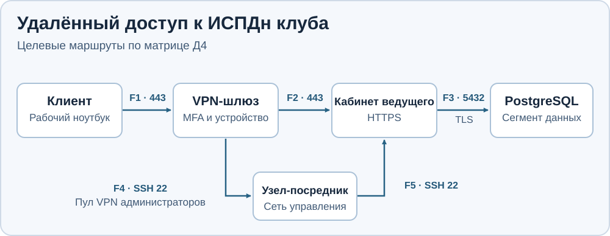
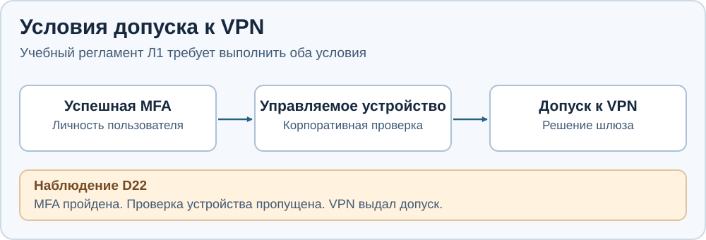
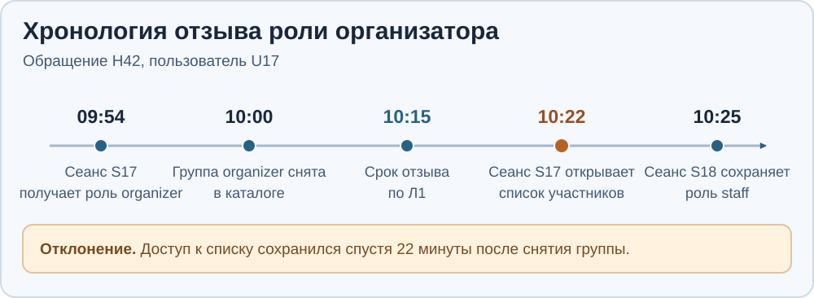

# Лабораторная работа 2

**Тема** — «Анализ защищённости удалённого доступа сотрудников к кадровой ИСПДн».

Подготовил Ижутов Михаил Алексеевич. Аудитория — старшие курсы направления «Информационная безопасность».

## 1. Цель и организация работы

### 1.1. Цель

Научиться анализировать удалённый доступ к кадровой информационной системе персональных данных (ИСПДн). Студент определяет границы объекта и уровень защищённости (УЗ), проверяет допуск к сети и кадровым записям, сопоставляет журналы и составляет заключение о проверенной выборке.

### 1.2. Обоснование выбора темы

Сотрудник может успешно войти через VPN и при этом получить лишний сетевой маршрут или доступ к записям другого отдела. После перевода у него может остаться активный сеанс с прежними правами. На одном кадровом портале можно рассмотреть каждое из этих решений и подобрать отдельные доказательства. Сюжет позволяет связать сетевую защиту с правами по трудовой функции и условиями обработки ПДн работников.

### 1.3. Разделы, темы и результаты

| Раздел | Тема | Результат |
|---|---|---|
| I. Обследование | Т1. Границы кадровой ИСПДн и определение УЗ | Паспорт границ, сценарий угрозы и обоснование УЗ |
| II. Допуск и права | Т2. VPN, MFA и состояние устройства | Таблица решений VPN и критерии повторной проверки |
| II. Допуск и права | Т3. Роли и полномочия на кадровом портале | Матрица ролей и замечание по области кадрового отчёта |
| II. Допуск и права | Т4. Сегментация удалённого доступа | Матрица потоков и условия проверки маршрутов |
| III. Проверка мер | Т5. Проверка сетевых СЗИ | Карточка правила и вывод по документам на версию |
| III. Проверка мер | Т6. Журналирование и отзыв доступа | Хронология отзыва роли и итоговое заключение |

### 1.4. Порядок занятия

Откройте план курса, затем разберите паспорт, нормативные основания и темы Т1–Т6 по порядку. Практики можно выполнять в парах, используя один протокол. После шестой темы проведите обмен результатами и выполните итоговый экзамен. [Публичное изложение плана](#12-публичное-изложение-плана-курса)

## 2. Учебная модель и исходные материалы

ООО «Маяк» использует кадровый портал для учёта работников. Удалённый сотрудник работает через VPN, сервер портала использует своё подключение к PostgreSQL, а обслуживание идёт через узел-посредник. Для учебного объекта подготовлены вымышленные выписки о допуске, правилах и сеансах.

*Рисунок 1. Маршрут сотрудника к кадровому порталу и отдельный путь администрирования. Обозначения F1–F5 используются в матрице Д4.*

| Материал | Содержание | Где используется |
|---|---|---|
| Д1 и Д1‑У | Паспорт и отдельная вводная о типе угроз | Т1 и границы остальных проверок |
| Д2 | Учебный регламент Л1 и четыре результата допуска к VPN | Т2, Т3, Т6 |
| Д3 | Проверки действий ролей на портале | Т3 |
| Д4 | Целевая и наблюдаемая матрицы сетевых потоков | Т4, Т5 |
| Д5 | Конфигурация фильтра, событие J56 и карточка версии | Т5 |
| Д6 | Обращение H42 и события двух сеансов | Т6 |

Исходное состояние описано наблюдениями. Студенты определяют целевое состояние и ожидаемые результаты проверки после изменений. Статус «подтверждено повторной проверкой» требует нового наблюдения. [Исходные материалы Д1–Д6](case.md)

## 3. Нормативные основания и порядок выполнения

| Стадия | Основные источники | Вспомогательные документы |
|---|---|---|
| Классификация и УЗ | 152‑ФЗ, постановление № 1119, ст. 88 ТК РФ для данных работников | Паспорт объекта и методика оценки угроз ФСТЭК |
| Требования защиты | Ст. 19 152‑ФЗ, постановление № 1119 и приказ ФСТЭК № 21 | Учебный регламент, руководства NIST о доступе и аутентификации |
| Анализ и аудит | Ст. 18.1 и 19 152‑ФЗ, приказ ФСТЭК № 21 | ГОСТ Р 56045-2021 и учебная форма протокола |
| Аттестация объекта | Приказ ФСТЭК № 77 при наличии основания | Паспорт, модель угроз и программа испытаний |
| Сертификация СЗИ | Приказ ФСТЭК № 55 для процедуры сертификации | Реестр ФСТЭК и документы на версию и исполнение |

В кейсе обосновывают УЗ кадровой ИСПДн. Категорирование КИИ применяют при наличии признаков соответствующего режима. Данные о VPN оценивают по Л1, а применимость требований к СКЗИ устанавливают по назначению и документам средства. [Полный реестр, иерархия и применимость](norms.md)

## 4. Темы и практические задания

### Т1. Границы кадровой ИСПДн и определение УЗ

**Теория и знания.** Состав ИСПДн, сетевые зоны, категории ПДн, круг субъектов и тип актуальных угроз. [Слайды лекции](lectures/01-scope.marp.md)

**Нормативная основа.** Н1 определяет ИСПДн. Н2 устанавливает условия выбора уровня, М1 помогает описать угрозу.

**Практика и умения.** Показать границы, выявить недостающий фактор и обосновать уровень по постановлению № 1119.

1. По Д1 отметить ноутбук, VPN, каталог, портал, БД, сеть управления и журналы.
2. Составить путь обращения к кадровому сервису и записать, какие сведения известны для УЗ.
3. По Д1‑У выбрать подпункт требований. Для F6 отдельно записать источник угрозы, актив и возможное последствие.

**Результат.** Паспорт границ, сценарий угрозы и обоснование УЗ.

**Критерий выполнения.** Область отражает сетевой путь и места хранения данных. Приведены основание для УЗ и условие из дополнительной вводной.

### Т2. VPN, MFA и состояние устройства

**Теория и знания.** Разница между проверкой личности, многофакторной аутентификацией и контролем состояния устройства. Назначение отдельной группы администраторов. [Слайды лекции](lectures/02-vpn.marp.md)

**Нормативная основа.** Н4, пп. 8.1–8.2, задаёт направления аутентификации и контроля доступа. Л1 задаёт два конкретных условия, М2 и М3 помогают разобрать этапы проверки.

**Практика и умения.** Проверить решение VPN по журналу и определить, какое условие политики выполнено.

1. Сопоставить D21–D23 с двумя условиями допуска из Д2.
2. Отдельно проверить, в какую зону отнесено подключение D24.
3. Описать повторные проверки для управляемого устройства с MFA, личного устройства и отказа MFA.

**Результат.** Таблица решений VPN и критерии повторной проверки.

**Критерий выполнения.** Для каждого решения записаны оба условия, вывод связан с конкретным событием. Штатный допуск и два отказа имеют проверяемые ожидания.

### Т3. Роли и полномочия на кадровом портале

**Теория и знания.** Права сотрудника, кадрового специалиста и администратора. Связь разрешённого действия с конкретной записью или подразделением. [Слайды лекции](lectures/03-roles.marp.md)

**Нормативная основа.** Н3 и Н4, п. 8.2, связывают доступ с полномочиями. Л1 конкретизирует роли и область записей для портала.

**Практика и умения.** Проверить разницу между доступом к функции и доступом к данным в результате этой функции.

1. По Д2 и Д3 записать допустимые объекты для ролей `staff`, `hr` и `admin`.
2. Сверить наблюдения P31–P34 с критериями. Указать, какой доступ вышел за границы роли.
3. Для P33 задать ожидаемый состав отчёта и указать, какие результаты P31 и P34 должны сохраниться.

**Результат.** Матрица ролей и замечание по области кадрового отчёта.

**Критерий выполнения.** Указана допустимая область кадровых записей. Вывод опирается на состав отчёта, а в доказательстве используются обезличенные сведения.

### Т4. Сегментация удалённого доступа

**Теория и знания.** Служебное подключение к БД, пользовательский и административный пулы VPN, трактовка сетевой достижимости. [Слайды лекции](lectures/04-segments.marp.md)

**Нормативная основа.** Н4, пп. 8.2 и 8.13, используется для анализа разграничения доступа и защиты взаимодействия сегментов. Порты и зоны задаёт локальная матрица Д4.

**Практика и умения.** Сопоставить целевой поток с наблюдаемым и запланировать проверку из нужной зоны.

1. Сопоставить схему и Д4. Отметить пользовательские, служебные и административные соединения.
2. Определить фактические отклонения. Отдельно указать, что именно подтверждает наблюдение F6.
3. Описать положительные результаты для F2–F5 и отрицательные для F6–F7.

**Результат.** Матрица потоков и условия проверки маршрутов.

**Критерий выполнения.** По F6 доказана только достижимость порта. План фиксирует источник, назначение, ожидаемое действие и сохранение рабочих соединений.

### Т5. Проверка сетевых СЗИ

**Теория и знания.** Порядок выбора правила фильтра. Роль журнала и проверка области сертификации по исполнению и версии. [Слайды лекции](lectures/05-controls.marp.md)

**Нормативная основа.** Н4 даёт основания оценки мер. Н5 относится к аттестации объекта и применяется при наличии основания. Н6 и М5 относятся к документам о продукте, М4 помогает оформить доказательство.

**Практика и умения.** Связать разрешённое соединение с правилом, а вывод по документации ограничить известными фактами.

1. По D51 и J56 сопоставить целевой запрет F6 и сработавшее правило.
2. Предложить изменение результата фильтрации. Записать ожидаемую запись об отказе и какие рабочие потоки сохраняются.
3. По D52 сверить версию и составить запрос документов на установленную версию.

**Результат.** Карточка правила и вывод по документам на версию.

**Критерий выполнения.** Причина F6 прослеживается по правилу и журналу. Документальный вывод указывает, какое подтверждение ещё требуется.

### Т6. Журналирование и отзыв доступа

**Теория и знания.** Значение пользователя, времени и ID сеанса для сопоставления событий. Разница в полномочиях старого и нового сеанса после смены группы. [Слайды лекции](lectures/06-revocation.marp.md)

**Нормативная основа.** Н1, ст. 19, связывает меры с обеспечением безопасности обработки. Н4, п. 8.5, охватывает регистрацию событий. Л1 задаёт срок отзыва, М3 помогает рассмотреть активный сеанс.

**Практика и умения.** По журналам проверить срок отзыва и подготовить критерии для двух видов доступа.

1. По Д6 связать H42, пользователя, снятие группы и оба сеанса.
2. Рассчитать интервал до кадрового доступа в S17 и сравнить его со сроком Л1.
3. Составить повторный тест для кадрового отчёта и просмотра своей карточки. Свести подтверждённые отклонения Т1–Т6 в заключение.

**Результат.** Хронология отзыва роли и итоговое заключение.

**Критерий выполнения.** Интервал рассчитан по связанным записям. Указаны ожидаемый отказ для кадрового отчёта и сохранение базовой роли.

## 5. Подготовка и итоговый комплект материалов

Преподаватель готовит паспорт, таблицы Д2–Д5, журналы Д6 и пустую форму протокола. Вводную Д1‑У выдают после фиксации недостающего параметра. На сдачу представьте один Markdown-файл с разделами Т1–Т6 и заключением. В каждой строке протокола укажите исходный факт и ожидаемый результат повторной проверки.

### Форма протокола

| Тема | Объект, поток или действие | Критерий и основание | Наблюдение и ID источника | Вывод и возможное последствие | Ожидаемый результат повторной проверки |
|---|---|---|---|---|---|
| Т… | … | … | … | … | … |

## 6. Проверка выполнения

| Критерий | Что проверяет преподаватель |
|---|---|
| Объект и границы | Узел, поток или роль относятся к кадровой ИСПДн из паспорта |
| Нормативная применимость | Указано подходящее основание, локальный критерий либо оба источника |
| Доказательство | Записан конкретный результат, по которому можно проверить вывод |
| Вывод | Отмечены последствия и граница подтверждённого результата |
| Повторная проверка | Ограничение проверяют вместе с сохранением нужной функции |

За каждый критерий присуждается до 1 балла по каждой практике. Экзамен оценивается отдельно, максимум 20 баллов. [Материалы преподавателя](instructor.md)

## 7. Доклады, мастер-классы и публичное представление

Во вводной части преподаватель представляет объект и план курса. После практик группы показывают ход одной проверки и передают соседней группе выбранную строку протокола. [План выступления в Marp](presentation.marp.md) · [Регламент обмена](exchange.md)

## 8. Краткие лекции

### 8.1. Т1. Границы кадровой ИСПДн и определение УЗ

Состав ИСПДн определяют по данным, функциям и компонентам. В учебном объекте сотрудник проходит через VPN, а кадровые сведения получает с портала. Сервер портала взаимодействует с БД, каталог хранит сведения о пользователях и группах. Сеть управления и журналы позволяют проверить административные действия. Для УЗ важны категория ПДн, круг субъектов, при необходимости их число и тип угроз. Из данных о доступности порта можно описать отдельный сценарий угрозы, а тип угроз для расчёта берут из Д1‑У. [Слайды в Marp](lectures/01-scope.marp.md)

### 8.2. Т2. VPN, MFA и состояние устройства

Многофакторная аутентификация (MFA) подтверждает пользователя с помощью нескольких факторов. Управляемость устройства подтверждает отдельная корпоративная проверка. По Л1 VPN разрешает вход только при успешной MFA и подтверждённом состоянии управляемого устройства. Если в журнале проверка устройства пропущена, одного успешного входа недостаточно для выполнения Л1. Протокол должен показывать результат каждого условия и решение шлюза. [Слайды в Marp](lectures/02-vpn.marp.md)

*Рисунок 2. Для допуска к VPN проверяют два условия. D22 показывает, какой шаг пропустили.*

### 8.3. Т3. Роли и полномочия на кадровом портале

После допуска в сеть портал проверяет прикладные полномочия. Сотрудник открывает свою карточку. Кадровый специалист получает сведения по назначенному отделу. Администратору нужны данные о состоянии системы. Для кадровой роли проверяют функцию и область её результата. Если отчёт открывается штатно, отдельная проверка состава строк должна подтвердить, что каждая запись относится к разрешённому отделу. [Слайды в Marp](lectures/03-roles.marp.md)

### 8.4. Т4. Сегментация удалённого доступа

VPN выдаёт клиенту доступ к определённой группе сетевых ресурсов. Сотруднику нужен портал, а подключение к БД выполняет сервер портала. Администратор использует выделенный путь через узел-посредник. Для каждой проверки фиксируют зону источника, назначение, протокол и результат. Доступный TCP-порт подтверждает достижимость, а чтение данных проверяется иными доказательствами. [Слайды в Marp](lectures/04-segments.marp.md)

### 8.5. Т5. Проверка сетевых СЗИ

В кейсе фильтр применяет первое совпавшее правило. Конфигурация объясняет, почему цель и наблюдение расходятся. Связь подтверждает журнал с идентификатором потока, правилом и действием. Отдельно проверяют формуляр, реестровые сведения и документы о версии. Аттестация оценивает объект в установленном порядке, а сертификация СЗИ относится к продукту и области его подтверждения. [Слайды в Marp](lectures/05-controls.marp.md)

### 8.6. Т6. Журналирование и отзыв доступа

Смена группы в каталоге и изменение полномочий в открытом сеансе наблюдаются в разных источниках. Для проверки отзыва сравнивают время события каталога со временем решения портала по тому же пользователю. Срок берут из локального регламента. Повторный тест должен показать отказ при открытии кадрового отчёта в старом сеансе и сохранение просмотра своей карточки. [Слайды в Marp](lectures/06-revocation.marp.md)

*Рисунок 3. Хронология отзыва роли по обращению H42. Граница в 10:15 следует из регламента кейса.*

## 9. Сквозное практическое задание

### 9.1. Задание и подготовка

Подготовьте заключение о защищённости удалённого доступа к кадровой ИСПДн. Используйте [паспорт и приложения Д1–Д6](case.md), [нормативный реестр](norms.md) и [форму протокола](#форма-протокола). Сначала выпишите критерии, затем сопоставьте их с наблюдениями. Все операции прорабатываются на выданных материалах.

### 9.2. Методика выполнения

| Шаг | Действие | Материал к сдаче |
|---|---|---|
| 1 | Выделить контур и обосновать УЗ по Д1 и Д1‑У | Паспорт и схема |
| 2 | Сверить допуск VPN с MFA и проверкой устройства | Таблица решений D21–D24 |
| 3 | Проверить границы роли и состава отчёта | Матрица ролей и замечание |
| 4 | Найти отклонения в сетевых потоках | Матрица Д4 с целевыми результатами |
| 5 | Связать наблюдение F6 с правилом и журналом. Сверить версию СЗИ | Карточка проверки и запрос документов |
| 6 | Сопоставить события отзыва роли и обобщить подтверждённые результаты | Хронология, ретест и итоговое заключение |

### 9.3. Оформление материалов

Сохраните документ `Фамилия_кадровая_ИСПДн.md`. В выводе укажите подтверждённые отклонения, недостающие документы и две приоритетные проверки после исправления. Например, проверить закрытие прямого доступа к БД из пула сотрудников и сохранение соединения портала с БД. Для отзыва роли укажите, когда старый сеанс теряет кадровые права и как проверяется сохранение базового доступа. Итог — заполненный протокол и заключение из 3–5 предложений.

## 10. Итоговый экзамен

Выберите по одному ответу в каждом вопросе. В общем кейсе обоснуйте выводы исходными наблюдениями. Для части Б можно использовать нормативный реестр и пустую форму протокола.

### 10.1. Часть А. Тест на 12 баллов

| № | Вопрос | А | Б | В |
|---|---|---|---|---|
| 1 | Какой документ задаёт условия определения УЗ? | ПП РФ № 1119 | Приказ ФСТЭК № 55 | Регламент VPN |
| 2 | При известных составе ПДн и статусе субъектов что уточняют для выбора УЗ? | Версию ОС | Тип актуальных угроз | Номер заявки |
| 3 | Что подтверждает управляемость устройства в кейсе? | Факт успешной MFA | Наличие браузера | Результат проверки соответствия корпоративным требованиям |
| 4 | Личное устройство прошло MFA и получило допуск. Как оценить результат по Л1? | Условие допуска соблюдено | Нарушено условие об управляемом устройстве | Подтверждён доступ к БД |
| 5 | Какой тест подтверждает границы роли `hr`? | Сверка номера порта | Проверка только открытия отчёта | Сверка состава строк с назначенным отделом |
| 6 | Для чего выделена роль `admin` в примере? | Для технического обслуживания | Для выгрузки кадровых данных всех отделов | Для работы за любого сотрудника |
| 7 | Из пула VPN сотрудники достигают TCP/5432. Что подтверждено? | Получены записи PostgreSQL | Сетевой порт достижим из этого пула | Служебная роль БД активирована |
| 8 | Как проверить исправление F6? | Осмотреть только скриншот правила | Выключить шлюз на время проверки | Проверить отказ F6 и сохранение F2 и F3 |
| 9 | Что подтверждает выбор правила R40 для F6? | Запись J56 с потоком, правилом и действием | Список кадровых ролей | Версия сертификата |
| 10 | Что требуется для оценки охвата новой версии СЗИ? | Имя продукта | Сетевой порт | Реестровые и эксплуатационные документы по версии и исполнению |
| 11 | Как проверить срок прекращения кадровых полномочий? | Сопоставить время снятия роли и решение портала в старом сеансе | Убедиться, что включена MFA | Проверить результат только новой авторизации |
| 12 | Какой результат сохраняют после перевода по условиям кейса? | Любые права бывшего отдела | Доступ к своей карточке в роли `staff` | Прежние поля кадрового отчёта |

За каждый верный ответ начисляется 1 балл.

### 10.2. Часть Б. Новый вариант кейса на 8 баллов

Частная организация обрабатывает иные ПДн 90 действующих работников. По учебной вводной актуальны угрозы третьего типа. Л1 допускает управляемое устройство с MFA и требует снять кадровые полномочия в активном сеансе не позднее 15 минут. В отчёте кадрового специалиста есть строки чужого отдела. Клиентский пул VPN достигает порта БД, хотя целевая матрица запрещает прямой поток. Портал использует своё разрешённое соединение с БД. Документы на межсетевой экран указывают версию 6.1, установлена 6.2. В 11:00 снята группа `hr`, в 11:20 прежний сеанс открывает кадровый отчёт. Новый сеанс позволяет просмотреть собственную карточку.

| № | Что представить | Баллы |
|---|---|---|
| Б1 | Определить УЗ и указать условия соответствующего подпункта | 2 |
| Б2 | Назвать два условия допуска сотрудника к VPN | 1 |
| Б3 | Указать отклонение в области кадровой роли и критерий исправления | 1 |
| Б4 | Сформулировать два результата повторной сетевой проверки | 1 |
| Б5 | Сделать ограниченный документальный вывод по версии 6.2 | 1 |
| Б6 | Рассчитать интервал отзыва, оценить его по Л1 и указать, какие права сохраняются | 2 |

Зачёт требует минимум 12 из 20 баллов и минимум 4 из 8 за общий кейс.

[Ключ и критерии начисления баллов](instructor.md#ключ-к-тесту)

## 11. Обмен материалами, доклады и мини-мастер-классы

Шесть групп получают по одной теме. Каждая группа объясняет вывод, затем показывает один шаг проверки на выданных материалах.

| Группа | Доклад | Мини-мастер-класс | Материал для обмена |
|---|---|---|---|
| Т1 | Что входит в границы кадровой ИСПДн | Найти в паспорте исходные параметры и применить Д1‑У | Схема и обоснование УЗ |
| Т2 | Как проверяют допуск к VPN | Сопоставить D21–D23 с критериями MFA и устройства | Таблица допусков и критерии повторной проверки |
| Т3 | Как ограничивают кадрового специалиста своим отделом | Найти расхождение в P33 | Матрица ролей и строка замечания |
| Т4 | Как отделяют рабочий трафик от управления | Отметить F2, F3 и F6 на схеме | Матрица потоков и ожидаемые результаты |
| Т5 | Что подтверждает срабатывание межсетевого экрана | Связать D51, J56 и F6 | Карточка проверки правила и запрос документов |
| Т6 | Почему после перевода проверяют активный сеанс | Сопоставить события H42 в каталоге и портале | Хронология и протокол отзыва |

Группа сохраняет `Тn_группа.md` в общей папке занятия или в LMS. Укажите критерий, ID наблюдения и вывод. Соседняя группа проверяет, хватает ли доказательств, и задаёт один вопрос. После обмена авторы уточняют протокол. [Форма протокола](#форма-протокола)

## 12. Публичное изложение плана курса

Тексты и заметки для десяти слайдов приведены ниже. [Презентация в Marp Markdown](presentation.marp.md)

### 12.1. Слайд 1. Анализ защищённости удалённого доступа

Кадровая ИСПДн частной организации

Ижутов Михаил Алексеевич

**Заметка докладчику.** Назовите тему и объект обследования.

### 12.2. Слайд 2. Почему выбран удалённый доступ

Сотрудник подключается к сети через VPN. Доступ к кадровым данным зависит от устройства, роли и состояния сеанса.

**Заметка докладчику.** Покажите, почему для кадровых данных нужно проверить больше одного этапа допуска.

### 12.3. Слайд 3. Границы учебной системы

Рабочий ноутбук подключается к VPN-шлюзу. Кадровый портал работает в отдельном сегменте и обращается к PostgreSQL.

Администрирование идёт через выделенный узел.

**Заметка докладчику.** Покажите путь сотрудника и отдельный путь администратора.

### 12.4. Слайд 4. Документы и локальные критерии

- 152-ФЗ и ст. 88 ТК РФ задают обязанности и условия доступа к данным работников.
- Постановление № 1119 задаёт условия определения УЗ.
- Приказ ФСТЭК № 21 и локальный регламент помогают задать критерии проверки.

**Заметка докладчику.** Объясните, что УЗ зависит от исходных данных.

### 12.5. Слайд 5. Раздел I. Обследование

Студент описывает контур, выясняет состав ПДн и определяет УЗ по вводной о типе угроз.

**Заметка докладчику.** Покажите, какой параметр запрашивается отдельно.

### 12.6. Слайд 6. Раздел II. Допуск и права

- VPN проверяет пользователя и состояние устройства.
- Портал применяет полномочия роли.
- Матрица потоков описывает подключения между сегментами.

**Заметка докладчику.** Разберите различие между успехом MFA и допуском устройства.

### 12.7. Слайд 7. Раздел III. Проверка мер

Срабатывание межсетевого экрана подтверждает журнал.

Отзыв кадровой роли проверяют по решению портала в ранее открытом сеансе.

**Заметка докладчику.** Сопоставьте журнал фильтра с потоком, затем покажите события снятия роли.

### 12.8. Слайд 8. Материалы практики

Один протокол объединяет схему, критерии, результаты и ожидаемую повторную проверку.

В заключении указывают подтверждённые отклонения и вопросы к документам.

**Заметка докладчику.** Приведите пример результата со ссылкой на идентификатор из кейса.

### 12.9. Слайд 9. Обмен и мини-мастер-классы

Каждая группа показывает один шаг проверки и передаёт соседней группе строку протокола для взаимной проверки.

**Заметка докладчику.** Дайте пример вопроса к материалу соседней группы.

### 12.10. Слайд 10. Итоговый экзамен

12 вопросов и новый вариант кейса.

Зачёт от **12 из 20 баллов**, включая **не менее 4 из 8 за кейс**.

**Заметка докладчику.** Напомните, что кейс проверяет применение критериев к новым данным.
