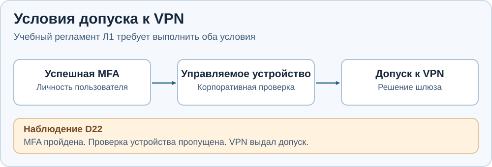
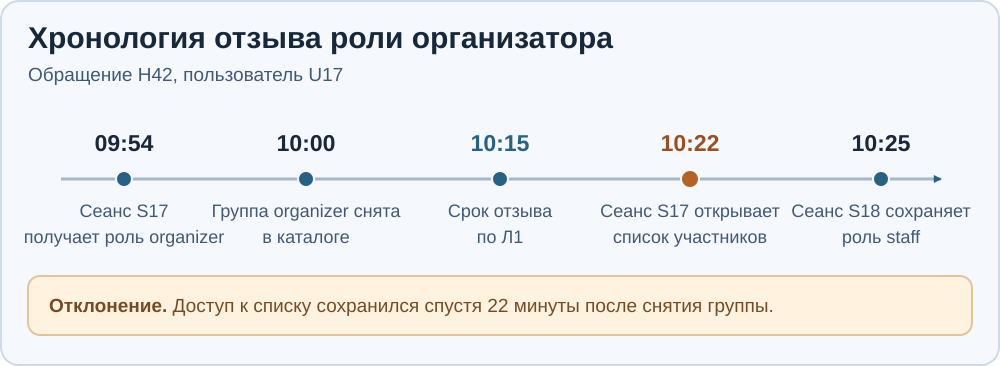

# Лекция по теме 2

Анализ защищённости удалённого доступа ведущих к кабинету клуба «В гостях у троллей».

[Лабораторная работа](laba2.md) · [Практика](practice.md) · [Обоснование по нормативам](norms.md#обоснование-по-блокам)

## Т1. Границы ИСПДн клуба и определение УЗ

**Что нужно знать.** Состав ИСПДн, сетевые зоны, категории ПДн, круг субъектов и тип актуальных угроз.

Состав ИСПДн определяют по данным, функциям и компонентам. В учебном объекте ведущий проходит через VPN, а списки участников получает с портала. Сервер портала взаимодействует с БД, каталог хранит сведения о пользователях и группах. Сеть управления и журналы позволяют проверить административные действия. Для УЗ важны категория ПДн, круг субъектов, при необходимости их число и тип угроз. Из данных о доступности порта можно описать отдельный сценарий угрозы, а тип угроз для расчёта берут из Д1‑У. [Слайды в Marp](lectures/01-scope.marp.md)

## Т2. VPN, MFA и состояние устройства

**Что нужно знать.** Разница между проверкой личности, многофакторной аутентификацией и контролем состояния устройства. Назначение отдельной группы администраторов.

Многофакторная аутентификация (MFA) подтверждает пользователя с помощью нескольких факторов. Управляемость устройства подтверждает отдельная корпоративная проверка. По Л1 VPN разрешает вход только при успешной MFA и подтверждённом состоянии управляемого устройства. Если в журнале проверка устройства пропущена, одного успешного входа недостаточно для выполнения Л1. Протокол должен показывать результат каждого условия и решение шлюза. [Слайды в Marp](lectures/02-vpn.marp.md)

*Рисунок 2. Для допуска к VPN проверяют два условия. D22 показывает, какой шаг пропустили.*

## Т3. Роли и полномочия в кабинете ведущего

**Что нужно знать.** Права сотрудника, ведущего и администратора. Связь разрешённого действия с конкретной записью или мероприятием.

После допуска в сеть портал проверяет прикладные полномочия. Сотрудник открывает своё расписание. Клубный специалист получает сведения по назначенной игротеке. Администратору нужны данные о состоянии системы. Для роли организатора проверяют функцию и область её результата. Если отчёт открывается штатно, отдельная проверка состава строк должна подтвердить, что каждая запись относится к разрешённой игротеке. [Слайды в Marp](lectures/03-roles.marp.md)

## Т4. Сегментация удалённого доступа

**Что нужно знать.** Служебное подключение к БД, пользовательский и административный пулы VPN, трактовка сетевой достижимости.

VPN выдаёт клиенту доступ к определённой группе сетевых ресурсов. Сотруднику нужен портал, а подключение к БД выполняет сервер портала. Администратор использует выделенный путь через узел-посредник. Для каждой проверки фиксируют зону источника, назначение, протокол и результат. Доступный TCP-порт подтверждает достижимость, а чтение данных проверяется иными доказательствами. [Слайды в Marp](lectures/04-segments.marp.md)

## Т5. Проверка сетевых СЗИ

**Что нужно знать.** Порядок выбора правила фильтра. Роль журнала и проверка области сертификации по исполнению и версии.

В кейсе фильтр применяет первое совпавшее правило. Конфигурация объясняет, почему цель и наблюдение расходятся. Связь подтверждает журнал с идентификатором потока, правилом и действием. Отдельно проверяют формуляр, реестровые сведения и документы о версии. Аттестация оценивает объект в установленном порядке, а сертификация СЗИ относится к продукту и области его подтверждения. [Слайды в Marp](lectures/05-controls.marp.md)

## Т6. Журналирование и отзыв доступа

**Что нужно знать.** Значение пользователя, времени и ID сеанса для сопоставления событий. Разница в полномочиях старого и нового сеанса после смены группы.

Смена группы в каталоге и изменение полномочий в открытом сеансе наблюдаются в разных источниках. Для проверки отзыва сравнивают время события каталога со временем решения портала по тому же пользователю. Срок берут из локального регламента. Повторный тест должен показать отказ при открытии списка участников в старом сеансе и сохранение просмотра своей карточки. [Слайды в Marp](lectures/06-revocation.marp.md)

*Рисунок 3. Хронология отзыва роли по обращению H42. Граница в 10:15 следует из регламента кейса.*
