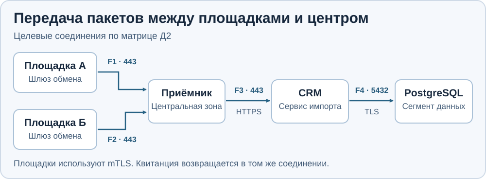

# Учебный кейс «Обмен списками между площадками клуба»

Объект этой работы — клуб настольных игр «В гостях у троллей». [Общая учебная легенда](../1%20%D1%82%D0%B5%D0%BC%D0%B0/club.md)

Все названия, результаты и идентификаторы вымышлены. Таблицы описывают подготовленную выборку наблюдений. Идентификаторы D, F, M, P и J используются для ссылок в протоколе.

## Карта исходных материалов

*Рисунок 1. Целевые соединения F1–F4. Прямые соединения F5 и F6 контролируются отдельно по матрице Д2.*

| Материал | Содержание | Применение |
|---|---|---|
| Д1 и Д1‑У | Паспорт и вводная о типе угроз | Т1 |
| Д2 | Целевые и наблюдаемые потоки | Т2 и Т5 |
| Д3 | Результаты взаимной аутентификации и допуска к очередям | Т3 |
| Д4 | Ответы на новую и повторную доставки | Т4 и Т6 |
| Д5 | Правило фильтра, запись J55 и документы на СЗИ | Т5 |
| Д6 | Выписки журналов приёмника и CRM | Т6 |

## Д1. Паспорт объекта

По легенде клуб «В гостях у троллей» проводит игры на площадках А и Б. Организаторы отмечают посещение и передают изменения в центральную CRM клуба. Пакет содержит ID игрока, ID игры и отметку о посещении. Список для подтверждения записи может содержать имя и телефон. В общей ИСПДн 1 200 уникальных совершеннолетних участников, которые не являются сотрудниками оператора. Это иные ПДн. Обе площадки в учебной модели обслуживаются одним оператором в России. В паспорте отсутствуют признаки ГИС и объекта КИИ.

Границы включают формирование пакета на площадке, шлюзы обмена, канал связи, центральный приёмник, CRM, PostgreSQL и журналы. Приёмник возвращает квитанцию по тому же соединению. Шлюзы площадок имеют отдельные служебные сертификаты.

**Д1‑У. Дополнительная вводная.** В модели угроз учебной организации актуальны угрозы третьего типа. Преподаватель сообщает это после того, как студенты назовут недостающий параметр для определения УЗ.

## Д2. Матрица потоков

| Поток | Источник | Назначение | Целевое правило | Наблюдение |
|---|---|---|---|---|
| F1 | Шлюз А | Приёмник, HTTPS/443 с mTLS | Разрешить передачу А | Штатная передача проходит |
| F2 | Шлюз Б | Приёмник, HTTPS/443 с mTLS | Разрешить передачу Б | Штатная передача проходит |
| F3 | Центральный приёмник | Сервис CRM, HTTPS/443 | Разрешить загрузку принятых пакетов | Служебный импорт проходит |
| F4 | Сервис CRM | PostgreSQL, TLS/5432 | Разрешить соединение служебной роли | Служебное соединение проходит |
| F5 | Шлюз Б | Центральный PostgreSQL, TCP/5432 | Блокировать прямой доступ | TCP-соединение устанавливается. Допуск к БД и операции не проверялись |
| F6 | Шлюз А | Шлюз Б, HTTPS/443 | Блокировать прямой обмен | Фильтр отклоняет поток |

## Д3. TLS и полномочия отправителя

Локальный регламент Л1 требует проверить имя центрального сервиса `obmen.trolli.example`, доверие и срок сертификатов. Приёмник использует проверенный служебный сертификат для идентификации отправителя. Площадка имеет право передавать только в закреплённую за ней очередь. Очередь определяется сервером по служебной идентичности и правилам доступа.

| ID | Учебная проверка | Результат TLS | Результат прикладной авторизации |
|---|---|---|---|
| M31 | Доверенные сертификаты. Отправитель А передаёт в очередь А | Успех | Допуск |
| M32 | Доверенные сертификаты. Отправитель Б обращается к очереди А | Успех. Приёмник распознал отправителя Б | Допуск к очереди А |
| M33 | Отдельный тест имени: сервер предъявляет только SAN `arhiv.trolli.example`, ожидается `obmen.trolli.example` | Отказ проверки имени. Цепочка и срок по условиям теста корректны | Операция не начинается |

## Д4. Целостность и повторная доставка

По Л1 приёмник сравнивает вычисленный хеш с ожидаемым значением из метаданных, полученных по аутентифицированному каналу. Запись об успешно обработанном пакете содержит пару «отправитель, ID пакета» и его хеш. Повтор с тем же хешем возвращает статус `duplicate` без нового импорта. Совпавший идентификатор с отличающимся хешем получает статус `conflict`. Пакет с нарушенной целостностью получает `invalid`. При успехе квитанция содержит `accepted`. Квитанции содержат только код площадки, ID пакета и статус.

| ID | Сценарий | Проверка целостности | Наблюдение при импорте |
|---|---|---|---|
| P41 | Первая доставка пакета А/42 из 200 записей | Хеш совпал | Квитанция `accepted`, создано 200 записей |
| P42 | Повторная доставка того же А/42 с тем же хешем после потери квитанции | Хеш совпал | Квитанция `accepted`, создано ещё 200 записей |
| P43 | Доставка пакета Б/11 с несовпадением хеша | Хеш не совпал | Квитанция `invalid`, создано 0 записей |

Проверку `conflict` студенты формулируют как план ретеста. Для этого сценария наблюдение не выдано.

## Д5. Правило фильтрации и документы на СЗИ

| ID | Материал | Содержание |
|---|---|---|
| D51 | Выписка о порядке правил | В учебном экране применяется первое совпадение. Правило R27 разрешает трафик сегмента шлюзов к центральному сегменту и расположено перед запретом F5 |
| J55 | Событие межсетевого экрана | F5, совпало правило R27, действие `allow` |
| D52 | Карточка поставщика | В карточке указана версия 7.3, в конфигурации — 7.4. Формуляр установленного исполнения и подтверждение охвата обновления в комплекте отсутствуют |

После изменения правила необходимы отказ F5 и сохранение F1–F4. По версии 7.4 запрашивают дополнительные документы. Название и версии продукта условные.

## Д6. Учебные журналы приёма и импорта

Л1 разрешает регистрировать время, код площадки, идентификатор пакета, статус, ID попытки и число обработанных строк. Тело пакета и контактные телефоны в диагностические события не включаются.

| ID | Время UTC+3 | Источник | Содержание |
|---|---|---|---|
| J61 | 09:00 | Приёмник | А/42, попытка R01, хеш совпал, `accepted` |
| J62 | 09:01 | CRM | А/42, попытка R01, создано 200 записей |
| J63 | 09:08 | Приёмник | А/42, попытка R02, хеш совпал, `accepted`. Диагностическое обогащение добавило поле «телефон» из локального списка. Значение скрыто в выписке |
| J64 | 09:09 | CRM | А/42, попытка R02, создано ещё 200 записей |

Для вывода о дубле сопоставляют ID отправителя, ID пакета и разные ID попыток. Журнал приёмника подтверждает решение о приёме. Журнал импорта подтверждает количество вновь созданных записей.
