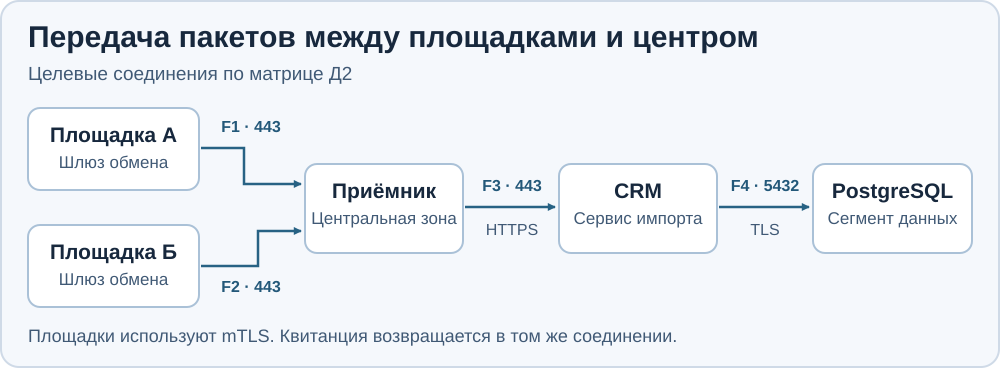
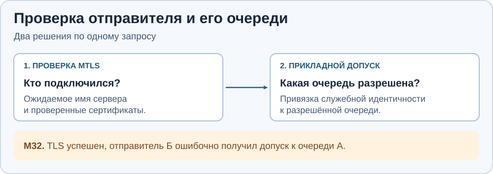
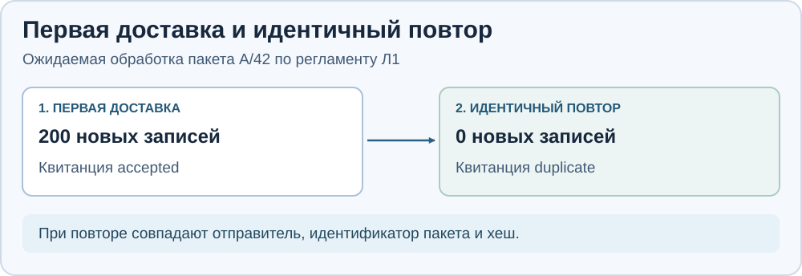

# Лабораторная работа 2

**Тема** — «Анализ защищённости передачи персональных данных между филиалами».

Подготовил Ижутов Михаил Алексеевич. Аудитория — студенты старших курсов направления «Информационная безопасность».

## 1. Цель и организация работы

### 1.1. Цель

Научиться оценивать межфилиальный обмен в информационной системе персональных данных (ИСПДн). Студент определяет границы объекта, устанавливает учебный уровень защищённости (УЗ), проверяет разрешённые маршруты, права отправителя и целостность доставки. Результат работы — протокол проверки с наблюдениями и ожидаемыми результатами после исправлений.

### 1.2. Обоснование темы

Отделения отправляют пакеты клиентских данных в центральную CRM. Система принимает решение на нескольких уровнях. Сетевые правила ограничивают достижимость сервисов, TLS подтверждает участников соединения, приложение ограничивает очередь отправителя, а импорт определяет, изменятся ли записи. Если квитанция потеряна, шлюз может повторить отправку. Этот случай позволяет проверить целостность обработки по журналам приёма и по фактическому эффекту в базе.

### 1.3. Разделы, темы и результаты

| Раздел | Тема | Результат |
|---|---|---|
| I. Обследование | Т1. Границы ИСПДн и уровень защищённости | Паспорт границ, сценарий угрозы и расчёт УЗ |
| II. Канал и импорт | Т2. Сегментация потоков между филиалами | Матрица потоков и критерии повторной проверки |
| II. Канал и импорт | Т3. Взаимная аутентификация и доступ к очередям | Карточка проверки имени и полномочий |
| II. Канал и импорт | Т4. Целостность пакета и повторная доставка | Протокол импорта и таблица ожидаемых результатов |
| III. Сетевая защита и аудит | Т5. Проверка сетевых средств защиты | Вывод о фильтрации и запрос документов |
| III. Сетевая защита и аудит | Т6. Журналы и доказательства | Сводка доказательств и итоговое заключение |

### 1.4. Порядок работы

Откройте план курса, изучите паспорт и нормативные основания. Выполните задания Т1–Т6 в порядке из раздела 4, затем представьте один результат на мини-мастер-классе. После обмена пройдите итоговый экзамен. [План курса](#12-публичное-изложение-плана-курса)

## 2. Учебная модель и исходные данные

ООО «Северный сервис» передаёт контактные сведения клиентов двух филиалов в одну CRM. У каждого филиала свой шлюз обмена и своя очередь. Центральный приёмник возвращает статус по исходному соединению, а CRM отдельно подключается к PostgreSQL. В исходных материалах используются вымышленные наблюдения без значений контактов.

*Рисунок 1. Целевые соединения F1–F4. Прямые соединения F5 и F6 контролируются отдельно по матрице Д2.*

| Материал | Содержание | Применение |
|---|---|---|
| Д1 и Д1‑У | Паспорт и вводная о типе угроз | Т1 |
| Д2 | Целевые и наблюдаемые потоки | Т2 и Т5 |
| Д3 | Результаты взаимной аутентификации и допуска к очередям | Т3 |
| Д4 | Ответы на новую и повторную доставки | Т4 и Т6 |
| Д5 | Правило фильтра, запись J55 и документы на СЗИ | Т5 |
| Д6 | Выписки журналов приёмника и CRM | Т6 |

Исходное состояние описывают выданными наблюдениями. Целевое состояние задаёт локальный регламент Л1. Протокол повторной проверки в этой работе содержит ожидаемые результаты, для подтверждения которых понадобятся новые наблюдения. [Учебный кейс](case.md)

## 3. Нормативная база и порядок применения

| Стадия | Основные основания | Вспомогательные материалы |
|---|---|---|
| Классификация и определение УЗ | 152‑ФЗ и ПП РФ № 1119 | Паспорт и методика ФСТЭК по оценке угроз |
| Требования по защите | Ст. 19 152‑ФЗ, ПП РФ № 1119, приказ ФСТЭК № 21 | Л1, RFC 8446 и RFC 9525 |
| Анализ и аудит | Ст. 18.1 и 19 152‑ФЗ, приказ ФСТЭК № 21 | ГОСТ Р 56045-2021 и протокол |
| Аттестация и сертификация | Приказ ФСТЭК № 77 для аттестации в области его действия. Приказ ФСТЭК № 55 для сертификации СЗИ | Паспорт, модель угроз, программа испытаний и документы на исполнение продукта |

По паспорту рассматривается режим ИСПДн частного оператора. Категорию значимости КИИ определяют при наличии оснований для применения соответствующего режима. Критерии mTLS в работе относятся к учебному обмену, применимость требований к СКЗИ оценивают по документам и условиям эксплуатации. Коды Н1–Н6, М1–М5 и Л1 расшифрованы в реестре. [Нормативная база](norms.md)

## 4. Темы и практические задания

### Т1. Границы ИСПДн и уровень защищённости

**Теория и знания.** Категория данных, число уникальных субъектов, тип угроз и область обследования. [Слайды лекции](lectures/01-scope.marp.md)

**Нормативная основа.** Н1 определяет ИСПДн, Н2 задаёт условия УЗ, М1 даёт метод оценки угроз.

**Практика и умения.** Определить область анализа, сформулировать недостающий параметр и обосновать УЗ.

1. По Д1 перечислить сегменты, компоненты и места хранения.
2. Записать категорию, статус и число субъектов. Сформулировать, каких сведений не хватает.
3. Применить Д1‑У, выбрать подпункт требований и описать одно возможное последствие доступа из филиала напрямую к БД.

**Результат.** Паспорт границ, сценарий угрозы и расчёт УЗ.

**Критерий выполнения.** Указаны условия для каждого вывода и ссылка на подпункт № 1119.

### Т2. Сегментация потоков между филиалами

**Теория и знания.** Источник, назначение и направление начала соединения. Сетевой критерий для F1–F6. [Слайды лекции](lectures/02-flows.marp.md)

**Нормативная основа.** Н3, пп. 8.2 и 8.13, задаёт основу анализа доступа и межсегментного взаимодействия. Д2 конкретизирует потоки.

**Практика и умения.** Сверить целевые и фактические связи. Установить, какой вывод подтверждает доступность порта.

1. По схеме отметить филиалы, приёмник, CRM и сегмент БД.
2. Сравнить цели и наблюдения по F1–F6. Указать границу вывода по F5.
3. Записать отрицательные тесты F5 и F6 и положительные тесты F1–F4.

**Результат.** Матрица потоков и критерии повторной проверки.

**Критерий выполнения.** Каждый тест указывает источник, назначение, порт и ожидаемое действие.

### Т3. Взаимная аутентификация и доступ к очередям

**Теория и знания.** Серверное имя и SAN, доверие к сертификату, идентификация клиента при mTLS и прикладные полномочия. [Слайды лекции](lectures/03-mtls.marp.md)

**Нормативная основа.** Н3, пп. 8.1–8.2 и 8.13, даёт контекст. М2 и М3 определяют технические критерии TLS. Л1 задаёт привязку очереди.

**Практика и умения.** Разделить вывод о TLS и о допуске к очереди по одному результату.

1. Сверить ожидаемое имя, доверие и решение TLS по M31–M33.
2. Сопоставить распознанного отправителя и фактическую очередь.
3. Предложить ожидаемые результаты для своей очереди, чужой очереди и неверного имени.

**Результат.** Карточка проверки имени и полномочий.

**Критерий выполнения.** M32 и M33 описаны по разным критериям, критерий отказа записан для обоих случаев.

### Т4. Целостность пакета и повторная доставка

**Теория и знания.** Проверка хеша, ключ пакета, сохранение результата первого импорта и различие между повтором и конфликтом. [Слайды лекции](lectures/04-import.marp.md)

**Нормативная основа.** Н3, п. 8.9, даёт контекст целостности. Л1 определяет статус и ожидаемое изменение числа записей.

**Практика и умения.** По результатам двух доставок определить, возник ли повторный импорт, и построить критерии ретеста.

1. Сопоставить отправителя, ID, хеш и число созданных записей в P41 и P42.
2. Сравнить итог с Л1. Отдельно оценить P43.
3. Составить ожидаемые результаты для четырёх сценариев: новый пакет, идентичный повтор, конфликт ключа и несовпадение хеша при проверке целостности.

**Результат.** Протокол импорта и таблица ожидаемых результатов.

**Критерий выполнения.** Для каждого сценария указаны квитанция и число новых записей. Запланированный тест конфликта отмечен отдельно.

### Т5. Проверка сетевых средств защиты

**Теория и знания.** Приоритет правил, поля журнала, исполнение и версия СЗИ. Предмет аттестации и сертификации. [Слайды лекции](lectures/05-controls.marp.md)

**Нормативная основа.** Н3 относится к оценке мер, Н4 к аттестации объекта, Н5 и М5 к сертификации и сведениям о продукте.

**Практика и умения.** Найти сработавшее правило и выделить недостающие документы на версию.

1. Связать F5 с R27 по D51 и J55.
2. Задать критерий отказа F5 и сохранения служебных соединений.
3. Сверить данные D52 и составить запрос на формуляр и сведения об охвате установленной версии.

**Результат.** Вывод о фильтрации и запрос документов.

**Критерий выполнения.** Часть о фильтрации подкреплена наблюдением, а документальный вывод ограничен имеющимися сведениями.

### Т6. Журналы и доказательства

**Теория и знания.** Корреляция по ключу пакета и идентификатору попытки. Минимизация состава журналов. [Слайды лекции](lectures/06-audit.marp.md)

**Нормативная основа.** Н1, ст. 5, 18.1 и 19, задаёт общий контекст обработки и контроля. Н3, п. 8.5, касается регистрации, М4 помогает оформить оценку.

**Практика и умения.** Соединить записи приёма и импорта, доказать дубль и указать лишнее поле.

1. По Д6 сгруппировать записи по ключу пакета и разделить попытки.
2. Сопоставить две квитанции с изменениями CRM. Отметить лишнее поле в J63.
3. Подготовить ожидаемые записи после исправления и заключение по всем темам.

**Результат.** Сводка доказательств и итоговое заключение.

**Критерий выполнения.** Вывод о дубле подтверждается журналом CRM. В протоколе указаны служебные поля для корреляции.

## 5. Подготовка и итоговый комплект материалов

Преподаватель готовит паспорт, выписки о потоках и импорте, журнал и пустую форму протокола. Дополнительную вводную Д1‑У выдают после предварительного вывода Т1. Для сдачи соберите паспорт границ, таблицы по Т1–Т6 и краткое заключение в одном файле `Фамилия_обмен_филиалов.md`.

### Форма протокола

| Тема | Актив, поток или пакет | Критерий и основание | Наблюдение и ID | Вывод и последствие | Ожидаемый результат ретеста |
|---|---|---|---|---|---|
| Т… | … | … | … | … | … |

## 6. Проверка выполнения

| Критерий | Как проверить |
|---|---|
| Границы | Объект и поток согласованы с паспортом |
| Применимость | Положение документа или локальный критерий связаны с проверкой |
| Доказательность | В строке есть наблюдение с ID и понятное последствие |
| Точность вывода | Достижимость, аутентификация, прикладной допуск и результат импорта оценены отдельно |
| Повторная проверка | Задано наблюдаемое ограничение и сохранение рабочего сценария |

За каждый критерий практики можно получить 1 балл. Итоговый экзамен оценивается отдельно, максимум 20 баллов. [Материалы преподавателя](instructor.md)

## 7. Доклады, мастер-классы и публичное представление

Учебный блок открывается представлением плана курса. После практик группы показывают, как получили вывод из конкретной записи. [Презентация](presentation.marp.md) · [План обмена](exchange.md)

## 8. Краткие лекции

### 8.1. Т1. Границы ИСПДн и уровень защищённости

Объект описывают с момента формирования пакета до центральной записи. Включают шлюзы, приёмник, CRM, БД и журналы. Для УЗ важно общее количество уникальных субъектов ИСПДн. Студент сначала фиксирует недостающий тип угроз, затем применяет вводную Д1‑У. Для анализа одной сетевой угрозы указывает актив, источник возможного воздействия и последствие. [Слайды в Marp](lectures/01-scope.marp.md)

### 8.2. Т2. Сегментация потоков между филиалами

Шлюзам филиалов нужен доступ к приёмнику. В центральном контуре приёмник обращается к сервису CRM, а CRM использует свой доступ к PostgreSQL. Направление в матрице обозначает сторону, которая начинает соединение. Для оценки фильтрации фиксируют источник, назначение, порт и результат. Доступный TCP-порт доказывает достижимость в этой точке. Для оценки доступа к записям нужны отдельные наблюдения. [Слайды в Marp](lectures/02-flows.marp.md)

### 8.3. Т3. Взаимная аутентификация и доступ к очередям

Во взаимном TLS стороны проверяют сертификаты, а клиент сверяет ожидаемое имя сервиса с SAN. Приёмник устанавливает служебную идентичность филиала по проверенному сертификату. Приложение использует эту идентичность в отдельном решении о правах на очередь. При сверке M32 сравнивают очередь с правилом Л1. При сверке M33 отдельно оценивают совпадение имени сервиса. [Слайды в Marp](lectures/03-mtls.marp.md)

*Рисунок 2. Условие допуска к очереди. Наблюдение M32 разделяет результат mTLS и решение приложения.*

### 8.4. Т4. Целостность пакета и повторная доставка

Когда квитанция потеряна, шлюз может повторить доставку. Приёмник сравнивает хеш с метаданными, полученными по аутентифицированному каналу. Результат импорта учитывается под ключом из отправителя и ID пакета. Учёт должен согласовываться с изменениями в CRM, чтобы сбой между операциями не приводил к повторному импорту. Идентичный повтор получает квитанцию без второй записи, а тот же ключ с изменившимся содержимым требует отдельного решения. В протоколе фиксируют и квитанцию, и изменение числа записей. [Слайды в Marp](lectures/04-import.marp.md)

*Рисунок 3. Целевой результат для двух доставок одного пакета А/42. В протоколе отдельно фиксируются статус квитанции и число новых записей.*

### 8.5. Т5. Проверка сетевых средств защиты

Снимок целевого запрета описывает настройку. Порядок правил объясняет результат, когда сравнение прекращается на первом совпадении. Связь решения с конкретным правилом проверяют по журналу. Для оценки документов сверяют исполнение, версию и область сертификата. Аттестация относится к объекту, сертификация — к продукту в пределах процедуры. [Слайды в Marp](lectures/05-controls.marp.md)

### 8.6. Т6. Журналы и доказательства

Одна квитанция описывает решение приёмника. Для доказательства изменения в CRM связывают приём и импорт по отправителю, ID пакета и ID попытки. При повторе идентификатор пакета сохраняется, идентификатор попытки меняется. Диагностический журнал ограничивают служебными полями. Заключение указывает, какое наблюдение подтверждает вывод и какой результат ожидают после исправления. [Слайды в Marp](lectures/06-audit.marp.md)

## 9. Сквозное практическое задание

### 9.1. Задание и исходные материалы

Подготовьте заключение о защищённости обмена между филиалами. Используйте паспорт и данные Д1–Д6. Для каждого вывода укажите локальный критерий или нормативное основание и наблюдение, по которому можно проверить вывод. [Исходные материалы](case.md) · [Форма протокола](#форма-протокола)

### 9.2. Методика выполнения

| Шаг | Действие | Что сохраняется |
|---|---|---|
| 1 | Установить область системы и обосновать УЗ по Д1 и Д1‑У | Схема, исходные условия и подпункт |
| 2 | Сравнить потоки по Д2 | Строки отклонений и ожидаемых результатов |
| 3 | Проверить разделение идентификации филиала и права на очередь | Выводы по M31–M33 |
| 4 | Сравнить импорт при первой и повторной доставке | Ожидаемые квитанции и число записей |
| 5 | Сверить фильтр и область версии | Карточка F5, подтверждение из журнала и запрос документов |
| 6 | Связать записи приёмника и CRM | Сводка доказательств и вывод |

### 9.3. Оформление результата

В итоговом файле покажите отклонения по Т1–Т6 и разделите подтверждённые факты и вопросы к документам. Для повторной проверки укажите, какие разрешённые передачи сохраняются, как подтверждается отказ прямого доступа к БД и что означает нулевой прирост записей при повторе. Сформулируйте заключение по выборке в 3–5 предложениях.

## 10. Итоговый экзамен

В каждом вопросе выберите один вариант. Для общего кейса обоснуйте вывод по указанному наблюдению. Можно использовать нормативный реестр и пустую форму протокола.

### 10.1. Часть А. Тест на 12 баллов

| № | Вопрос | А | Б | В |
|---|---|---|---|---|
| 1 | По какому документу определяют УЗ? | Постановление № 1119 | Приказ № 55 | RFC 8446 |
| 2 | Какую величину используют в рассматриваемой классификации? | Число журналов | Число строк дневного файла | Число уникальных субъектов ИСПДн |
| 3 | Как оценивают успешное TCP-соединение по F5? | Доказывает чтение таблиц | Подтверждает достижимость порта из проверенного сегмента | Подтверждает импорт пакета |
| 4 | Что проверяют после закрытия F5? | Запрет F5 и работу F1–F4 | Только запись запрета в конфигурации | Остановку CRM |
| 5 | Доверие и срок сертификата в порядке, имя в SAN отличается. Каков результат? | Успех | Отказ проверки имени | Подтверждение полномочий |
| 6 | Отправитель Б успешно прошёл mTLS. Что проверяет приёмник дальше? | Номер порта БД | Разрешённую очередь для идентичности Б | Суммарное число клиентов |
| 7 | Тот же отправитель повторяет пакет с тем же ID и хешем. Какой результат ожидается? | `duplicate`, 0 новых записей | `accepted`, новая загрузка | `conflict`, новая загрузка |
| 8 | Идентификатор повторяется, хеш содержимого отличается и целостность новой передачи подтверждена. Что ожидается? | `conflict`, запись не меняется | Добавление новой копии данных | `duplicate` без регистрации расхождения |
| 9 | Как подтверждают, какое правило применилось к F5? | По названию продукта | По версии CRM | По журналу фильтра и конфигурации |
| 10 | Установлена более новая версия СЗИ, чем в карточке. Как проверить охват? | Достаточно открытого порта | Достаточно совпадения имени продукта | Сверить запись и документы на версию и исполнение |
| 11 | Какие сведения связывают две доставки одного пакета? | Только время | Отправитель и ID пакета. ID попыток различают доставки | Только код ответа |
| 12 | Что подтверждает создание повторных записей? | Сам факт второго TLS-сеанса | Наличие хеша в квитанции | Журнал CRM о втором изменении по тому же ключу пакета |

Один верный ответ даёт 1 балл.

### 10.2. Часть Б. Новый вариант кейса на 8 баллов

ИСПДн частной организации содержит иные ПДн 8 000 клиентов, которые не являются сотрудниками. По учебной вводной актуальны угрозы третьего типа. Пакеты идут через центральный приёмник. Отправитель В проходит mTLS и получает допуск к очереди Г. Шлюз В достигает TCP-порта центральной БД, хотя матрица разрешает к нему подключаться только CRM. Пакет В/18 при первой доставке создал 60 записей. После повторной доставки с тем же хешем журнал CRM показывает ещё 60 записей. В карточке экрана версия 5.0, установлена 5.1. В записи о повторном приёме присутствует электронная почта клиента, хотя Л1 разрешает только служебные поля.

| № | Что представить | Баллы |
|---|---|---|
| Б1 | Определить УЗ и указать исходные условия и соответствующий подпункт | 2 |
| Б2 | Оценить очередь по правилам прикладного доступа | 1 |
| Б3 | Указать отрицательную и положительную сетевые проверки | 1 |
| Б4 | Записать критерий обработки повтора В/18 и ожидаемое число новых записей | 1 |
| Б5 | Сделать вывод о документах на установленную версию СЗИ | 1 |
| Б6 | Назвать источник доказательства дубля и исправление записи журнала | 2 |

Зачёт требует минимум 12 из 20 баллов и минимум 4 из 8 за общий кейс.

[Ключ к экзамену и шкала для преподавателя](instructor.md#ключ-к-тесту)

## 11. Обмен материалами, доклады и мини-мастер-классы

Шесть групп получают по теме. Группа обосновывает вывод и показывает одно действие по материалам кейса.

| Группа | Доклад | Мини-мастер-класс | Материал для обмена |
|---|---|---|---|
| Т1 | Где проходят границы межфилиальной ИСПДн | По паспорту и Д1‑У обосновать УЗ | Схема и нормативное основание |
| Т2 | Как читать матрицу потоков | Сопоставить разрешённый F3 и запрещённый F5 | Таблица результатов по потокам |
| Т3 | Как идентичность филиала связывается с очередью | Показать отдельные выводы по M32 и M33 | Карточка проверок TLS и прав |
| Т4 | Почему повтор не должен второй раз менять CRM | Сопоставить P41 и P42 и записать ожидаемый итог | Протокол приёма и повтора |
| Т5 | Как подтвердить срабатывание сетевого правила | Найти R27 в конфигурации и в журнале | Карточка фильтра и запрос документов |
| Т6 | Чем подтверждается повторное изменение записей | Связать J61–J64 и указать лишнее поле | Сводка доказательств и вывод |

Группа сохраняет `Тn_группа.md` в общей папке занятия или LMS. В файле указывают критерий, наблюдение, вывод и ожидаемый результат повторной проверки. Соседняя группа проверяет связь вывода с данными и задаёт один вопрос. После обмена авторы уточняют протокол. [Форма протокола](#форма-протокола)

## 12. Публичное изложение плана курса

Ниже приведены тексты десяти слайдов с заметками для выступления. [Презентация в Marp](presentation.marp.md)

### 12.1. Слайд 1. Анализ защищённости передачи персональных данных между филиалами

Лабораторная работа на примере обмена пакетами с центральной CRM

Ижутов Михаил Алексеевич

**Заметка докладчику.** Назовите тему и объект работы.

### 12.2. Слайд 2. Зачем проверять обмен

Филиалы регулярно доставляют пакеты клиентских данных.

Проверка охватывает маршрут, полномочия отправителя и изменение записей в CRM.

**Заметка докладчику.** Поясните, как потеря квитанции влияет на повторную доставку.

### 12.3. Слайд 3. Объект и границы

Шлюзы двух филиалов подключаются к центральному приёмнику.

Импорт использует служебные подключения к CRM и базе данных.

**Заметка докладчику.** Покажите на схеме потоки F1–F4.

### 12.4. Слайд 4. Нормативные основания

- 152-ФЗ определяет обязанности оператора.
- Постановление № 1119 задаёт условия выбора УЗ.
- Приказ ФСТЭК № 21 связывает защиту с конкретными мерами.

**Заметка докладчику.** Назовите нормативные основания и роль модели угроз.

### 12.5. Слайд 5. Раздел I. Обследование

Студент выделяет зоны и каналы, определяет состав данных и обосновывает УЗ по учебной вводной.

**Заметка докладчику.** Поясните, почему учитывается число субъектов ИСПДн.

### 12.6. Слайд 6. Раздел II. Канал и импорт

Матрица описывает разрешённые маршруты.

Приёмник проверяет сертификат отправителя, право на очередь и целостность пакета.

**Заметка докладчику.** Разберите отличие проверки очереди от аутентификации.

### 12.7. Слайд 7. Раздел III. Сетевая защита и аудит

Правило фильтра подтверждается сетевым наблюдением и журналом.

Изменение базы подтверждается записью импорта.

**Заметка докладчику.** Дайте пример из F5 или А/42.

### 12.8. Слайд 8. Практический результат

Сдаётся один документ с паспортом, критериями, наблюдениями и планом повторной проверки.

**Заметка докладчику.** Покажите строку протокола.

### 12.9. Слайд 9. Доклады и мастер-классы

Шесть групп показывают по одной проверке и обмениваются доказательствами для взаимной оценки.

**Заметка докладчику.** Уточните, что получает соседняя группа.

### 12.10. Слайд 10. Итоговый экзамен

12 тестовых вопросов и новый кейс.

Зачёт от **12 из 20 баллов**, включая **не менее 4 из 8 за кейс**.

**Заметка докладчику.** Объясните шкалу и критерий доказательного вывода.
