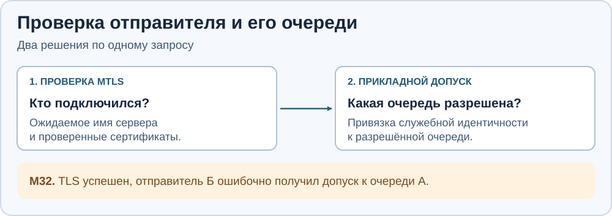
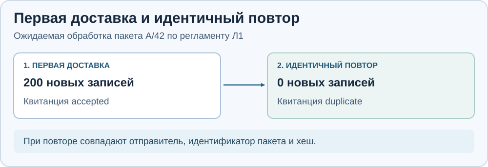

# Лекция по теме 3

Анализ защищённости обмена списками участников между площадками клуба «В гостях у троллей».

[Лабораторная работа](laba2.md) · [Практика](practice.md) · [Обоснование по нормативам](norms.md#обоснование-по-блокам)

## Т1. Границы ИСПДн и уровень защищённости

**Что нужно знать.** Категория данных, число уникальных субъектов, тип угроз и область обследования.

Объект описывают с момента формирования пакета до центральной записи. Включают шлюзы, приёмник, CRM, БД и журналы. Для УЗ важно общее количество уникальных субъектов ИСПДн. Студент сначала фиксирует недостающий тип угроз, затем применяет вводную Д1‑У. Для анализа одной сетевой угрозы указывает актив, источник возможного воздействия и последствие. [Слайды в Marp](lectures/01-scope.marp.md)

## Т2. Сегментация потоков между площадками

**Что нужно знать.** Источник, назначение и направление начала соединения. Сетевой критерий для F1–F6.

Шлюзам площадок нужен доступ к приёмнику. В центральном контуре приёмник обращается к сервису CRM, а CRM использует свой доступ к PostgreSQL. Направление в матрице обозначает сторону, которая начинает соединение. Для оценки фильтрации фиксируют источник, назначение, порт и результат. Доступный TCP-порт доказывает достижимость в этой точке. Для оценки доступа к записям нужны отдельные наблюдения. [Слайды в Marp](lectures/02-flows.marp.md)

## Т3. Взаимная аутентификация и доступ к очередям

**Что нужно знать.** Серверное имя и SAN, доверие к сертификату, идентификация клиента при mTLS и прикладные полномочия.

Во взаимном TLS стороны проверяют сертификаты, а клиент сверяет ожидаемое имя сервиса с SAN. Приёмник устанавливает служебную идентичность площадки по проверенному сертификату. Приложение использует эту идентичность в отдельном решении о правах на очередь. При сверке M32 сравнивают очередь с правилом Л1. При сверке M33 отдельно оценивают совпадение имени сервиса. [Слайды в Marp](lectures/03-mtls.marp.md)

*Рисунок 2. Условие допуска к очереди. Наблюдение M32 разделяет результат mTLS и решение приложения.*

## Т4. Целостность пакета и повторная доставка

**Что нужно знать.** Проверка хеша, ключ пакета, сохранение результата первого импорта и различие между повтором и конфликтом.

Когда квитанция потеряна, шлюз может повторить доставку. Приёмник сравнивает хеш с метаданными, полученными по аутентифицированному каналу. Результат импорта учитывается под ключом из отправителя и ID пакета. Учёт должен согласовываться с изменениями в CRM, чтобы сбой между операциями не приводил к повторному импорту. Идентичный повтор получает квитанцию без второй записи, а тот же ключ с изменившимся содержимым требует отдельного решения. В протоколе фиксируют и квитанцию, и изменение числа записей. [Слайды в Marp](lectures/04-import.marp.md)

*Рисунок 3. Целевой результат для двух доставок одного пакета А/42. В протоколе отдельно фиксируются статус квитанции и число новых записей.*

## Т5. Проверка сетевых средств защиты

**Что нужно знать.** Приоритет правил, поля журнала, исполнение и версия СЗИ. Предмет аттестации и сертификации.

Снимок целевого запрета описывает настройку. Порядок правил объясняет результат, когда сравнение прекращается на первом совпадении. Связь решения с конкретным правилом проверяют по журналу. Для оценки документов сверяют исполнение, версию и область сертификата. Аттестация относится к объекту, сертификация — к продукту в пределах процедуры. [Слайды в Marp](lectures/05-controls.marp.md)

## Т6. Журналы и доказательства

**Что нужно знать.** Корреляция по ключу пакета и идентификатору попытки. Минимизация состава журналов.

Одна квитанция описывает решение приёмника. Для доказательства изменения в CRM связывают приём и импорт по отправителю, ID пакета и ID попытки. При повторе идентификатор пакета сохраняется, идентификатор попытки меняется. Диагностический журнал ограничивают служебными полями. Заключение указывает, какое наблюдение подтверждает вывод и какой результат ожидают после исправления. [Слайды в Marp](lectures/06-audit.marp.md)
