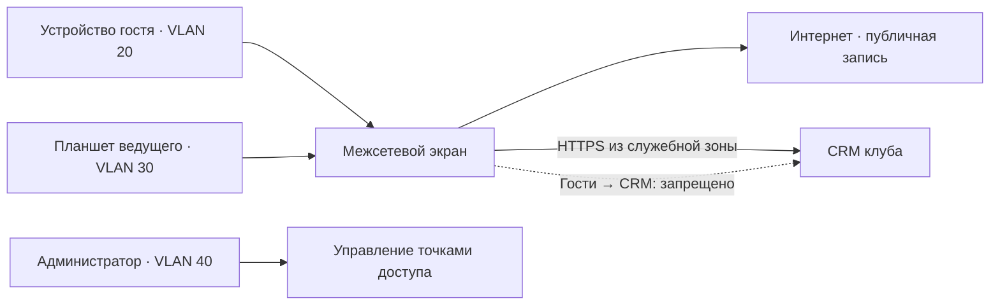
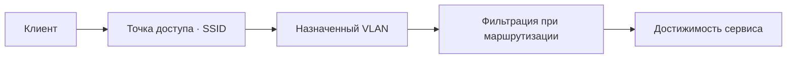
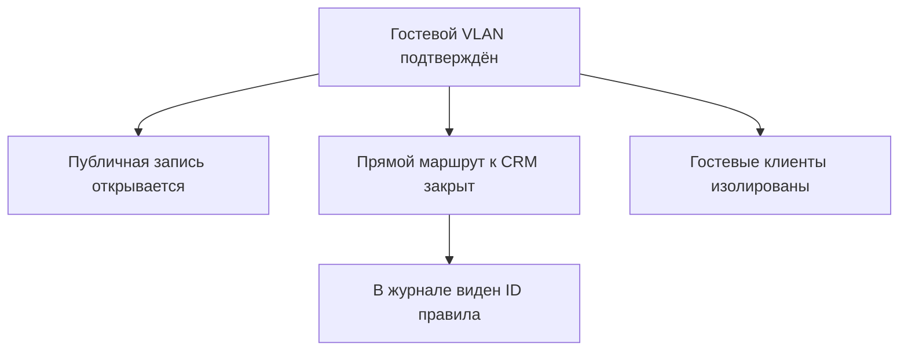

# Учебный кейс. Изоляция гостевого Wi-Fi

Все материалы условные. Используйте [общий паспорт клуба](../1%20%D1%82%D0%B5%D0%BC%D0%B0/club.md) и выданные в этом файле выписки. Для определения УЗ сначала прочитайте Д1, затем получите Д1‑У.

## Д1. Паспорт объекта

На площадке А работают две точки доступа AP1 и AP2. Они транслируют сети Trolli-Guest и Trolli-Staff. Рабочие планшеты ведущих открывают CRM для отметки посещений. Гости пользуются общей онлайн-формой через публичную точку входа. VLAN 20 отведён гостям, VLAN 30 — планшетам, VLAN 40 — администрированию. Межсетевой экран разделяет эти зоны и сегменты центральной ИСПДн.

Общие исходные данные клуба — 1 200 уникальных совершеннолетних участников, которые не являются работниками оператора. Обрабатываются иные категории ПДн. В учебном паспорте отсутствуют признаки ГИС и объекта КИИ. Первая версия Д1 не содержит типа угроз.

**Д1‑У. Дополнительная вводная.** Учебный оператор определил, что актуальны угрозы третьего типа. Преподаватель предоставляет эту вводную после того, как студенты назовут недостающий параметр для УЗ.

**Схема зон гостевой и служебной сети**

## Л4. Локальные критерии

Л4 разрешает гостям утверждённый резолвер, выход в интернет и публичную форму клуба по HTTPS. Гостям запрещены прямые подключения к CRM, БД и интерфейсу управления, а также обмен между беспроводными клиентами. Ведущие используют планшеты из служебной сети для работы с CRM по HTTPS. Управление точками доступа доступно из выделенной администраторской сети. Регламент требует записывать решения о запрете с отметкой времени, зоной и ID сработавшего правила.

## Д2. Сопоставление SSID и VLAN

| ID выписки | Точка | SSID | Профиль по Л4 | VLAN клиента по снимку |
|---|---|---|---|---|
| W21 | AP1 | Trolli-Guest | VLAN 20 | VLAN 20 |
| W22 | AP2 | Trolli-Guest | VLAN 20 | VLAN 30 |
| W23 | AP2 | Trolli-Staff | VLAN 30 | VLAN 30 |

В W22 DHCP-выдача и выписка точки доступа согласуются. Соединения из Д3 измерены для гостя на AP1 с подтверждённым VLAN 20.

## Д3. Матрица потоков и журнал фильтра

| Поток | Откуда → куда | Критерий Л4 | Наблюдение |
|---|---|---|---|
| F31 | Гость → публичная запись, HTTPS | Разрешить | Страница открылась |
| F32 | Планшет → CRM, HTTPS | Разрешить | Карточка своей игры открылась |
| F33 | Гость → внутренний адрес CRM, TCP/443 | Блокировать | Соединение установлено. Чтение данных не проверялось |
| F34 | Гость → PostgreSQL, TCP/5432 | Блокировать | Фильтр отклоняет соединение |
| F35 | Гость → утверждённый DNS | Разрешить | Ответ получен |

Фильтр применяет первое совпадение. R14 допускает любой локальный сегмент к CRM по TCP/443. R25 запрещает гостевой поток к CRM и стоит ниже R14. J46 содержит идентификатор F33, действие allow и правило R14.

## Д4. Связь между гостевыми устройствами

Проверки сняты в отдельном тестовом снимке, где у обеих точек правильный гостевой VLAN 20.

| ID | Размещение клиентов | Ожидание | Наблюдение |
|---|---|---|---|
| I41 | Оба на AP1 | Обмен запрещён | Тестовый кадр до второго клиента не дошёл |
| I42 | Один на AP1, другой на AP2 | Обмен запрещён | Второй клиент получил тестовый кадр |

## Д5. Сеть управления

| ID | Источник → интерфейс управления AP | Критерий | Наблюдение |
|---|---|---|---|
| M51 | Администраторская сеть | Разрешить | HTTPS и вход администратора приняты |
| M52 | Планшет ведущего, VLAN 30 | Блокировать | TCP/443 доступен. Аутентификация не проверялась |
| M53 | Гость AP1, VLAN 20 | Блокировать | Соединение отклонено |

## Д6. Полнота журнала

| ID | Проверка | Результат |
|---|---|---|
| J61 | F33, разрешённое соединение | В выборке есть запись J46 |
| J62 | F34, запрещённое соединение | В выданной выборке запись о блокировке не найдена |

Оператору ещё предстоит уточнить полноту выгрузки и настройки регистрации на правиле F34. В журнале нужны служебные идентификаторы, без содержания заявок.

## Схемы к проверкам

**Точки контроля**

**Ожидаемые проверки после изменения**

