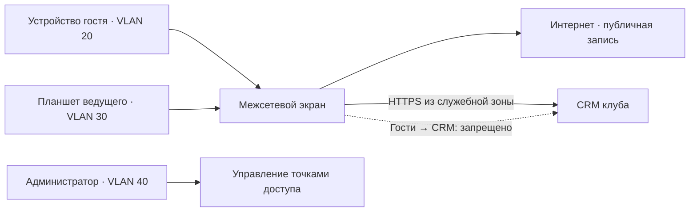
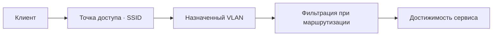
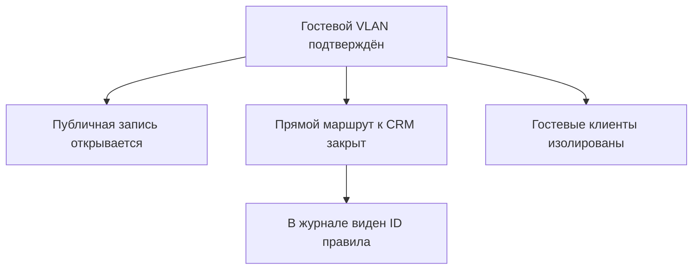

# Лабораторная работа по АБАС

**Тема** — Анализ изоляции гостевого Wi-Fi от служебной сети клуба «В гостях у троллей».

**Дисциплина** — «Анализ безопасности автоматизированных систем» (АБАС).

Подготовил Ижутов Михаил Алексеевич. Материал для старших курсов по информационной безопасности.

[Общий паспорт системы клуба и нормативные основания](../1%20%D1%82%D0%B5%D0%BC%D0%B0/club.md)

## 1. Цель и обоснование

Посетители открывают расписание и записываются на игры с телефонов. На той же площадке ведущие отмечают явку с рабочих планшетов. Ошибка привязки беспроводной сети к VLAN или разрешающее правило на шлюзе могут открыть гостям служебный интерфейс. Проверка показывает, где заканчивается работа точки доступа и начинается фильтрация между сетями.

Оценить разделение сети гостей, ведущих и администрирования, установить причину каждого выявленного отклонения и составить проверки, которые подтвердят исправление и сохранят онлайн-запись.

| Раздел | Блоки |
|---|---|
| I. Обследование системы | Т1–Т2 |
| II. Оценка мер и сбор доказательств | Т3–Т4 |
| III. Проверка результата и подготовка заключения | Т5–Т6 |

## 2. Учебная модель и исходные данные

Сведения условные. Технические выводы делайте по выданным выпискам. Общая архитектура, рабочие допущения и условные идентификаторы приведены в [паспорте клуба](../1%20%D1%82%D0%B5%D0%BC%D0%B0/club.md).

### Д1. Паспорт объекта

На площадке А работают две точки доступа AP1 и AP2. Они транслируют сети Trolli-Guest и Trolli-Staff. Рабочие планшеты ведущих открывают CRM для отметки посещений. Гости пользуются общей онлайн-формой через публичную точку входа. VLAN 20 отведён гостям, VLAN 30 — планшетам, VLAN 40 — администрированию. Межсетевой экран разделяет эти зоны и сегменты центральной ИСПДн.

Общие исходные данные клуба — 1 200 уникальных совершеннолетних участников, которые не являются работниками оператора. Обрабатываются иные категории ПДн. В учебном паспорте отсутствуют признаки ГИС и объекта КИИ. Первая версия Д1 не содержит типа угроз.

**Д1‑У. Дополнительная вводная.** Учебный оператор определил, что актуальны угрозы третьего типа. Преподаватель предоставляет эту вводную после того, как студенты назовут недостающий параметр для УЗ.

**Схема зон гостевой и служебной сети**

### Л4. Локальные критерии

Л4 разрешает гостям утверждённый резолвер, выход в интернет и публичную форму клуба по HTTPS. Гостям запрещены прямые подключения к CRM, БД и интерфейсу управления, а также обмен между беспроводными клиентами. Ведущие используют планшеты из служебной сети для работы с CRM по HTTPS. Управление точками доступа доступно из выделенной администраторской сети. Регламент требует записывать решения о запрете с отметкой времени, зоной и ID сработавшего правила.

### Д2. Сопоставление SSID и VLAN

| ID выписки | Точка | SSID | Профиль по Л4 | VLAN клиента по снимку |
|---|---|---|---|---|
| W21 | AP1 | Trolli-Guest | VLAN 20 | VLAN 20 |
| W22 | AP2 | Trolli-Guest | VLAN 20 | VLAN 30 |
| W23 | AP2 | Trolli-Staff | VLAN 30 | VLAN 30 |

В W22 DHCP-выдача и выписка точки доступа согласуются. Соединения из Д3 измерены для гостя на AP1 с подтверждённым VLAN 20.

### Д3. Матрица потоков и журнал фильтра

| Поток | Откуда → куда | Критерий Л4 | Наблюдение |
|---|---|---|---|
| F31 | Гость → публичная запись, HTTPS | Разрешить | Страница открылась |
| F32 | Планшет → CRM, HTTPS | Разрешить | Карточка своей игры открылась |
| F33 | Гость → внутренний адрес CRM, TCP/443 | Блокировать | Соединение установлено. Чтение данных не проверялось |
| F34 | Гость → PostgreSQL, TCP/5432 | Блокировать | Фильтр отклоняет соединение |
| F35 | Гость → утверждённый DNS | Разрешить | Ответ получен |

Фильтр применяет первое совпадение. R14 допускает любой локальный сегмент к CRM по TCP/443. R25 запрещает гостевой поток к CRM и стоит ниже R14. J46 содержит идентификатор F33, действие allow и правило R14.

### Д4. Связь между гостевыми устройствами

Проверки сняты в отдельном тестовом снимке, где у обеих точек правильный гостевой VLAN 20.

| ID | Размещение клиентов | Ожидание | Наблюдение |
|---|---|---|---|
| I41 | Оба на AP1 | Обмен запрещён | Тестовый кадр до второго клиента не дошёл |
| I42 | Один на AP1, другой на AP2 | Обмен запрещён | Второй клиент получил тестовый кадр |

### Д5. Сеть управления

| ID | Источник → интерфейс управления AP | Критерий | Наблюдение |
|---|---|---|---|
| M51 | Администраторская сеть | Разрешить | HTTPS и вход администратора приняты |
| M52 | Планшет ведущего, VLAN 30 | Блокировать | TCP/443 доступен. Аутентификация не проверялась |
| M53 | Гость AP1, VLAN 20 | Блокировать | Соединение отклонено |

### Д6. Полнота журнала

| ID | Проверка | Результат |
|---|---|---|
| J61 | F33, разрешённое соединение | В выборке есть запись J46 |
| J62 | F34, запрещённое соединение | В выданной выборке запись о блокировке не найдена |

Оператору ещё предстоит уточнить полноту выгрузки и настройки регистрации на правиле F34. В журнале нужны служебные идентификаторы, без содержания заявок.

### Схемы к проверкам

**Точки контроля**

**Ожидаемые проверки после изменения**

## 3. Нормативные основания

Сначала определите режим и УЗ по Н1 и Н2, затем выберите применимые меры по Н3. Сетевые и прикладные значения берите из Л4. Для оценки используйте М1 и М2. Если правовая обязанность зависит от дополнительного условия, укажите это условие в выводе.

| Назначение | Документ | Как применяется |
| --- | --- | --- |
| Н1 | [152‑ФЗ, ст. 5 и 19](https://www.consultant.ru/document/cons_doc_LAW_61801/) | Определить состав данных сетевого журнала и требования к обеспечению защищённости ИСПДн. Если оператор может связать сетевые идентификаторы с людьми, отдельно проверить режим их обработки. |
| Н2 | [ПП РФ № 1119, пп. 5–12](https://www.consultant.ru/document/cons_doc_LAW_137356/8c86cf6357879e861790a8a7ca8bea4227d56c72/) | Установить УЗ по категории ПДн, числу и статусу субъектов, типу угроз и конкретному подпункту. По Д1‑У применяется подп. «б» п. 12. |
| Н3 | [Приказ ФСТЭК № 21, пп. 8.2, 8.5, 8.13 и 8.15](https://www.consultant.ru/document/cons_doc_LAW_146520/) | Подобрать и адаптировать меры управления доступом, регистрации, защиты взаимодействия и конфигурации. Целевую матрицу и запрет на внутренний доступ задаёт Л4. |
| М1 | [IEEE 802.1Q‑2022](https://standards.ieee.org/ieee/802.1q/10323/) | Использовать терминологию VLAN и сопоставить карту портов с выбранной конфигурацией. Допустимые соединения определяет оператор. |
| М2 | [ГОСТ Р 56045‑2021](https://protect.gost.ru/gost/details/897416ef-4b50-4c57-aa81-6df5140e7e74) | Подготовить проверку мер по критериям и оформить доказательства, вывод и ограничения выборки. |

Оценка мер показывает результат проверенной выборки. Вопросы аттестации объекта, сертификации СЗИ и гражданско-правовых условий рассмотрены в [реестре применимости](norms.md).

## 4. Знания, умения и задания по блокам

### Т1. Границы и активы

**Знания.** Сегмент и компонент входят в область анализа, если через них проходят ПДн или от них зависит ограничение доступа к этим данным. Гостевой телефон находится вне доверенной зоны, а общие сетевые компоненты граничного контроля входят в область проверки.

**НПА и обоснование.** Н1 и Н2 связывают границу анализа с обработкой ПДн и исходными параметрами для УЗ. [Нормативная база](norms.md)

**Умения.** Обозначить телефоны, планшеты, точки доступа, шлюз, CRM и БД. Отметить внешнюю сеть и средства администрирования. По Д1‑У выписать условия выбора УЗ и указать подпункт.

**Материалы** — Д1 и Д1‑У. **Результат** — схема зон и ссылка на основание УЗ.

### Т2. SSID, VLAN и профиль клиента

**Знания.** SSID обозначает беспроводную сеть, которой соответствует профиль точки доступа. Для доказательства изоляции нужно сверить профиль и фактический VLAN клиента. Успешный выход в интернет возможен и при попадании гостя в служебную сеть.

**НПА и обоснование.** Н3 обосновывает управление конфигурацией. М1 помогает читать сетевую схему, а Л4 закрепляет соответствие гостевого профиля VLAN 20. [Нормативная база](norms.md)

**Умения.** Сверить AP1 и AP2 с целевыми профилями. Указать ID выписки и факт, подтверждающий классификацию клиента на AP2.

**Материалы** — Д2. **Результат** — таблица фактических и целевых назначений.

### Т3. Межсетевой экран и достижимость CRM

**Знания.** Матрица потоков задаёт ожидаемые решения. Выписка фильтра указывает правило, а наблюдение сети — фактическую достижимость. Успешное TCP-соединение само по себе не подтверждает чтение заявок.

**НПА и обоснование.** Н3 задаёт направления управления доступом и защиты взаимодействия. Л4 определяет, какие соединения разрешены. Журнал фильтра помогает обосновать причину отклонения. [Нормативная база](norms.md)

**Умения.** Сопоставить F31–F35 с порядком правил и J46. Для F33 указать причину и границы вывода. Записать штатный и запрещённый поток для повторной проверки.

**Материалы** — Д3. **Результат** — матрица и карточка нарушения.

### Т4. Изоляция клиентов внутри Wi-Fi

**Знания.** Два клиента одной беспроводной сети могут обмениваться трафиком через точки доступа и коммутатор. Блокировка внутри одной точки не доказывает изоляцию клиентов на разных точках.

**НПА и обоснование.** Н3 и Л4 обосновывают изоляцию. М1 позволяет учесть общий VLAN и путь через коммутатор при проверке клиентов на разных точках. [Нормативная база](norms.md)

**Умения.** Сопоставить I41 и I42 при одинаковом правильном VLAN. Записать, где изоляция подтверждена, и составить ретест для обеих пар.

**Материалы** — Д4. **Результат** — протокол проверки двух сценариев.

### Т5. Плоскость управления

**Знания.** Управление точкой доступа позволяет менять профили сети. Достижимость административного HTTPS и успешная аутентификация проверяются отдельно.

**НПА и обоснование.** Н3 и Л4 обосновывают ограничение плоскости управления. Критерий для проверки — доступ только из VLAN 40. [Нормативная база](norms.md)

**Умения.** Для M52 указать, что подтверждено, и сравнить его с M51 и M53. Записать, как оставить рабочим доступ администратора.

**Материалы** — Д5. **Результат** — матрица доступа к управлению.

### Т6. Журналы и повторная проверка

**Знания.** Протокол требует независимого доказательства результата и записи о срабатывании меры. Если ожидаемая запись отсутствует в выданной выборке, нужно проверить охват журнала и фильтр поиска, прежде чем выносить вывод обо всей системе.

**НПА и обоснование.** Н1 и Н3 задают основания для безопасного журналирования, Л4 определяет состав записи. М2 помогает оформить предел вывода по выборке. [Нормативная база](norms.md)

**Умения.** Заполнить карточку J62 с границей вывода. Построить план повтора W22, F33, I42 и M52 с положительными проверками для гостей и ведущих.

**Материалы** — Д6. **Результат** — программа повторной проверки с критериями и источниками.

## 5. Подготовка материалов к сдаче

Подготовьте один файл Markdown с паспортом, рабочими таблицами Т1–Т6 и заключением. Схему сохраняйте рядом с текстом. Ссылки на доказательства оформляйте по ID из входных материалов.

| Критерий | Источник и ID | Что наблюдали | Вывод и его граница | Ожидаемый результат повторной проверки |
|---|---|---|---|---|
| Правило или пункт Л4 | Выписка | Фактическое решение или измерение | Риск для процесса клуба | Штатное и запрещённое действие |

## 6. Проверка выполнения

За каждый из пяти признаков можно получить 1 балл. Область и УЗ обоснованы. Критерии связаны с правовыми и локальными основаниями. Доказательства можно найти по ID. Выводы соответствуют границам наблюдений. Повторная проверка учитывает штатный сценарий и отклонение. [Ожидаемые выводы для преподавателя](instructor.md)

## 7. Доклады и публичное представление

Группа выбирает наблюдение, показывает исходные данные и защищает вывод. Аудитория проверяет, можно ли повторить рассуждение по выданным сведениям. [План выступления в Marp](presentation.marp.md)

## 8. Краткие лекции

### 8.1. Границы и активы

Сегмент и компонент входят в область анализа, если через них проходят ПДн или от них зависит ограничение доступа к этим данным. Гостевой телефон находится вне доверенной зоны, а общие сетевые компоненты граничного контроля входят в область проверки.

[Лекция в Markdown для Marp](lectures/01-scope.marp.md)

### 8.2. SSID, VLAN и профиль клиента

SSID обозначает беспроводную сеть, которой соответствует профиль точки доступа. Для доказательства изоляции нужно сверить профиль и фактический VLAN клиента. Успешный выход в интернет возможен и при попадании гостя в служебную сеть.

[Лекция в Markdown для Marp](lectures/02-review.marp.md)

### 8.3. Межсетевой экран и достижимость CRM

Матрица потоков задаёт ожидаемые решения. Выписка фильтра указывает правило, а наблюдение сети — фактическую достижимость. Успешное TCP-соединение само по себе не подтверждает чтение заявок.

[Лекция в Markdown для Marp](lectures/03-evidence.marp.md)

### 8.4. Изоляция клиентов внутри Wi-Fi

Два клиента одной беспроводной сети могут обмениваться трафиком через точки доступа и коммутатор. Блокировка внутри одной точки не доказывает изоляцию клиентов на разных точках.

[Лекция в Markdown для Marp](lectures/04-analysis.marp.md)

### 8.5. Плоскость управления

Управление точкой доступа позволяет менять профили сети. Достижимость административного HTTPS и успешная аутентификация проверяются отдельно.

[Лекция в Markdown для Marp](lectures/05-control.marp.md)

### 8.6. Журналы и повторная проверка

Протокол требует независимого доказательства результата и записи о срабатывании меры. Если ожидаемая запись отсутствует в выданной выборке, нужно проверить охват журнала и фильтр поиска, прежде чем выносить вывод обо всей системе.

[Лекция в Markdown для Marp](lectures/06-conclusion.marp.md)

## 9. Сквозное практическое задание

**Задание.** Подготовьте заключение о проверенном процессе клуба. Опишите зависимость между участками системы, выберите существенные отклонения и составьте последовательность действий для их устранения.

1. По Д1 и Д1‑У определите состав системы и УЗ.
2. Для Т2–Т6 выпишите критерий из Л4, найдите связанные выписки и запишите наблюдаемый результат.
3. Для каждого отклонения укажите возможное последствие. Если наблюдения недостаточно, назовите недостающий источник.
4. Предложите повторные проверки и зафиксируйте, при каких наблюдениях защиту можно считать восстановленной на этой выборке.

## 10. Итоговый экзамен

За каждый правильный ответ в части А — 1 балл. В части Б каждое из четырёх заданий оценивается в 2 балла. Зачёт — от 12 из 20 баллов, включая минимум 4 из 8 за кейс.

### 10.1. Часть А. Тест на 12 баллов

| № | Вопрос | А | Б | В |
| --- | --- | --- | --- | --- |
| 1 | Что связывает SSID и служебный сетевой сегмент? | Цвет точки на схеме | Профиль сопоставления SSID и VLAN | Длина имени SSID |
| 2 | Какие параметры нужны для определения УЗ? | Число точек и портов | Производитель шлюза | Тип угроз, категория, число и статус субъектов |
| 3 | Что подтверждает W22? | Гостевой клиент оказался в VLAN 30 | Гость сменил пароль | Гость использовал кабинет ведущего |
| 4 | Чем подтвердить причину допуска F33? | Скриншотом публичной формы | Перечнем VLAN без журнала | Сопоставлением порядка правил с J46 |
| 5 | Что доказывает TCP-соединение F33? | Допустимость потока | Достижимость порта | Успешную выгрузку списка |
| 6 | Для чего проверяют I42? | Для проверки изоляции между точками | Для выбора УЗ | Для оценки сертификата сайта |
| 7 | Какой поток сохраняют после ограничения гостя? | Доступ гостя к БД | Выход гостя к публичной форме | Доступ гостя к CRM |
| 8 | Кто по Л4 вправе подключаться к управлению AP? | Администратор из VLAN 40 | Любой гость | Любой ведущий |
| 9 | Что делать с отсутствующей строкой J62? | Считать журнал выключенным | Считать фильтр исправным целиком | Уточнить полноту выгрузки и настройку правила |
| 10 | Чем опасно ошибочное назначение VLAN 30? | Сразу раскрывается пароль БД | К гостю могут примениться служебные сетевые права | Публичный сайт меняет сертификат |
| 11 | Как проверить запрет по матрице? | Убедиться, что есть VLAN 20 | Сверить паспорт без наблюдений | Сопоставить отрицательную проверку и решение фильтра |
| 12 | Какой материал подтверждает исправление W22? | Новый профиль и выписка с VLAN гостевого клиента | Список имён сетей | Повторная фотография площадки |

### 10.2. Часть Б. Практический кейс на 8 баллов

На площадке Б AP3 подключает гостевой клиент к VLAN 20. Гость открывает публичную запись. При соединении гостя со служебной CRM TCP/443 доступен, а журнал сообщает rule R18, allow. R18 расположен выше запрета гостевого доступа к CRM. Конфигурация управления разрешает администраторскую VLAN 40, но TCP/443 управления доступен и из VLAN 30. Чтение списков и вход в управление в материалах не наблюдались.

1. Обосновать ожидаемое решение для гостевого доступа к CRM и связать вывод с журналом.
2. Описать предел вывода для CRM и управления.
3. Составить проверку сегментации после исправления.
4. Составить проверку плоскости управления.

## 11. Обмен материалами, доклады и мини-мастер-классы

| Блок | Доклад | Мини-мастер-класс | Передаваемый материал |
| --- | --- | --- | --- |
| Т1. Границы и активы | Что относится к области проверки | Объяснить границу и назвать один недостающий вход для вывода | Схема зон и ссылка на основание УЗ. |
| Т2. SSID, VLAN и профиль клиента | Как проверить локальный критерий | Сопоставить выписку и целевое правило | Таблица фактических и целевых назначений. |
| Т3. Межсетевой экран и достижимость CRM | Какие источники нужно связать | Показать вывод на двух записях или проверках | Матрица и карточка нарушения. |
| Т4. Изоляция клиентов внутри Wi-Fi | Как обосновать предел вывода | Записать наблюдение и условие, которое требует отдельного подтверждения | Протокол проверки двух сценариев. |
| Т5. Плоскость управления | Как сохранить штатную работу | Парой контрольных сценариев проверить разрешённое и запрещённое действие | Матрица доступа к управлению. |
| Т6. Журналы и повторная проверка | Как оформлять повторную проверку | Заполнить одну строку программы и объяснить ожидаемый результат | Программа повторной проверки с критериями и источниками. |

Передайте другой группе один артефакт с ID наблюдения и сформулированным критерием. Получатель проверяет вывод и возвращает одно замечание, привязанное к выданному материалу. [Отдельный план обмена](exchange.md)

## 12. Публичное изложение темы

[Отдельная презентация из 10 слайдов](presentation.marp.md)

### 12.1. Изоляция гостевого Wi-Fi

Клуб настольных игр «В гостях у троллей»

Дисциплина «Анализ безопасности автоматизированных систем»

Ижутов Михаил Алексеевич

**Заметка докладчику.** Назовите процесс клуба и объясните, что студент должен подтвердить по результатам проверки.

### 12.2. Почему проверяем гостевой Wi-Fi

Посетители записываются на игротеки из гостевой сети. Ведущие используют служебные планшеты на той же площадке.

**Заметка докладчику.** Попросите назвать границу между публичной формой и внутренней CRM.

### 12.3. Объект и сетевые зоны

VLAN 20 — гости. VLAN 30 — ведущие. VLAN 40 — управление точками доступа.

**Заметка докладчику.** Откройте схему из учебного кейса и покажите пути гостя и планшета.

### 12.4. Нормативные основания

152‑ФЗ, ПП № 1119 и приказ ФСТЭК № 21 задают рамки защиты. Л4 определяет допустимые потоки.

**Заметка докладчику.** Покажите реестр требований и карту связей с наблюдениями.

### 12.5. Проверка привязки SSID

Сверяем конфигурацию обеих точек и фактическую сеть, выданную гостевому клиенту.

**Заметка докладчику.** Поясните, зачем нужны два источника для вывода о VLAN.

### 12.6. Фильтрация между зонами

Сравниваем матрицу потоков, результат соединения и сработавшее правило. Фиксируем границу вывода.

**Заметка докладчику.** Приведите пример отличия открытого порта от доступа к списку.

### 12.7. Изоляция клиентов и управление

Проверяем пары на одной и разных точках. Отдельно проверяем доступ к управлению из каждой зоны.

**Заметка докладчику.** Назовите штатный доступ администратора и запрещённый маршрут планшета.

### 12.8. Практический результат

Схема, матрица потоков и протокол. Для каждого отклонения есть ID наблюдения и ожидаемый результат повторной проверки.

**Заметка докладчику.** Покажите одну строку протокола по учебному снимку.

### 12.9. Обмен материалами

Группы защищают выводы по VLAN, фильтру, управлению и журналам. Соседняя группа проверяет достаточность доказательства.

**Заметка докладчику.** Откройте перечень мини-мастер-классов.

### 12.10. Экзамен

12 вопросов и новый вариант площадки. За практическую часть требуется не менее 4 из 8 баллов.

**Заметка докладчику.** Объясните, как оцениваются вывод и проверка после исправления.
