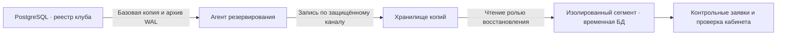
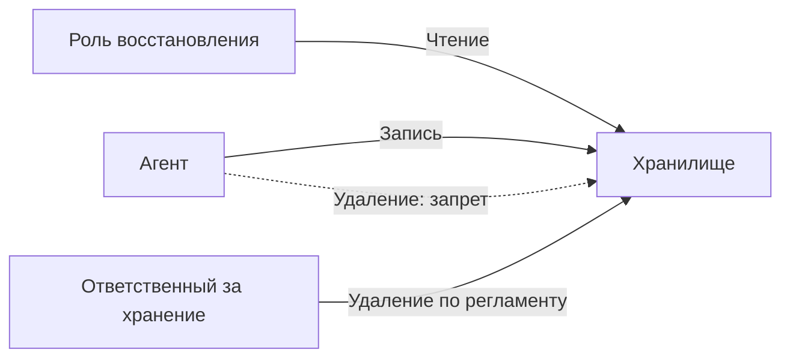
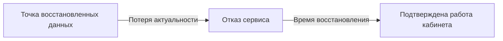

# Учебный кейс. Защита резервных копий реестра

Все материалы условные. Используйте [общий паспорт клуба](../1%20%D1%82%D0%B5%D0%BC%D0%B0/club.md) и выданные в этом файле выписки. Для определения УЗ сначала прочитайте Д1, затем получите Д1‑У.

## Д1. Паспорт объекта

Центральная PostgreSQL хранит заявки и отметки о посещении. Сервер резервирования передаёт базовые копии и архив WAL в отдельное хранилище. После условного отказа диска восстанавливают временную БД в изолированном сегменте. В области проверки находятся рабочая БД, архив, сетевые пути записи и чтения, роли хранения, временный экземпляр и протокол проверки кабинета.

Общие исходные данные клуба — 1 200 уникальных совершеннолетних участников, которые не являются работниками оператора. Обрабатываются иные категории ПДн. В учебном паспорте отсутствуют признаки ГИС и объекта КИИ. Первая версия Д1 не содержит типа угроз.

**Д1‑У. Дополнительная вводная.** Учебный оператор определил, что актуальны угрозы третьего типа. Преподаватель предоставляет эту вводную после того, как студенты назовут недостающий параметр для УЗ.

**Поток резервирования и восстановление в отдельном сегменте**

## Л5. Локальные критерии

По Л5 потеря актуальности восстановленных данных не должна превышать 10 минут (RPO), а возобновление проверенной работы кабинета — 90 минут от отказа (RTO). Копии остаются 14 суток по учебному регламенту. Агент может добавлять копии, роль восстановления — читать, удаление выполняет выделенная роль хранения по утверждённому сроку. Канал к хранилищу аутентифицирован, тестовое восстановление выполняют в отдельной зоне с запретом исходящей рассылки.

## Д2. Доступ к резервным копиям

| ID | Проверка | Ожидание Л5 | Результат |
|---|---|---|---|
| B21 | Агент записывает объект в хранилище | Разрешить | Запись выполнена, канал аутентифицирован |
| B22 | Агент пытается удалить тестовый объект в реплике настроек | Запретить | Удаление тестового объекта разрешено |
| B23 | Роль восстановления читает копию | Разрешить | Чтение успешно |
| B24 | Планшет ведущего подключается к хранилищу | Запретить | Сетевой фильтр блокирует |

## Д3. Выписка из каталога и архива WAL

| ID | Элемент | Наблюдение |
|---|---|---|
| C31 | Базовая копия | Доступна, проверка целостности прошла |
| C32 | Архив до 14:45 | Непрерывность WAL от базовой копии подтверждена |
| C33 | Интервал после 14:45 | Промежуточные файлы отсутствуют в доступной цепочке |
| C34 | Файл за 14:50 | Файл присутствует, непрерывность до этой отметки не подтверждена |

Время указано по одной шкале. Для учения используют последнюю подтверждённую точку 14:45. Количество заявок, которых нет в восстановленном состоянии, из временных отметок вычислить нельзя.

## Д4. Шкала восстановления

| Время | Наблюдение |
|---|---|
| 14:45 | Последнее подтверждённое состояние данных |
| 15:00 | Зафиксирован отказ диска и потеря сервиса |
| 15:43 | Запущена восстановленная БД в тестовом сегменте |
| 16:10 | Подтверждена работа кабинета с контрольными записями, выполнена проверка Д5 |

## Д5. Контроль результата и изоляции

| ID | Проверка | Наблюдение |
|---|---|---|
| V51 | Контрольная заявка, зафиксированная до 14:45 | Совпали ID, статус и ID игры |
| V52 | Связь отметки о посещении с записью об игроке | Контрольная связь сохранилась |
| V53 | Открытие списка своей игры и попытка открыть чужую запись | Свой список доступен, чужая запись запрещена |
| V54 | Попытка исходящего соединения со шлюзом рассылки | Фильтр тестового сегмента отклонил соединение |

## Д6. Хранение и контроль

| ID | Возраст копии на момент учения | Состояние |
|---|---|---|
| H61 | 2 суток | Копия присутствует, плановый срок не истёк |
| H62 | 17 суток | Копия присутствует, отдельное основание продления отсутствует |

Инвентарный журнал содержит идентификатор копии и отметки жизненного цикла. Для проверки не нужны поля заявок.

## Схемы к проверкам

**Контроль полномочий в хранилище**

**Измерение восстановления**

