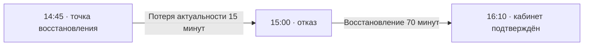

# Материалы преподавателя. Защита резервных копий реестра

Сначала выдайте Д1. Откройте Д1‑У после того, как студенты зафиксируют отсутствие типа угроз. При проверке обращайте внимание на связку критерия и конкретного наблюдения. [Учебный кейс](case.md) · [Экзамен](exam.md)

## Ожидаемые выводы практики

| Блок | Ожидаемые выводы |
| --- | --- |
| Т1 | УЗ‑4 по подп. «б» п. 12. Хранилище, временную БД и связанные роли включают в границы анализа. |
| Т2 | B22 подтверждает лишнее право удаления у агента в учебной реплике. После изменения B21 проходит, B22 отклоняется. |
| Т3 | По C31–C33 подтверждена точка 14:45. Наличие файла C34 без промежуточных сегментов не подтверждает более позднюю точку. |
| Т4 | RPO по наблюдению — 15 минут при цели 10. Восстановление заняло 70 минут при цели 90. |
| Т5 | V51, V52 и V53 подтверждают проверки приложения. V54 подтверждает запрет вызова шлюза уведомлений из тестового сегмента. |
| Т6 | H62 — копия 17 суток без исключения по вводной. Проверить очищение по Л5 уполномоченной ролью с фиксацией результата и сохранением свежей рабочей копии. |

**Измерение восстановления в учебном кейсе**

## Ключ теста

| Вопрос | 1 | 2 | 3 | 4 | 5 | 6 | 7 | 8 | 9 | 10 | 11 | 12 |
| --- | --- | --- | --- | --- | --- | --- | --- | --- | --- | --- | --- | --- |
| Ответ | В | А | Б | А | В | Б | В | А | Б | Б | А | В |

## Проверка кейса

| Задание | Два балла за полный ответ |
| --- | --- |
| 1 | 7 минут, цель 10 минут соблюдена. |
| 2 | 105 минут, цель 90 минут не соблюдена. |
| 3 | У планировщика лишнее удаление. После исправления запись разрешена, удаление запрещено. |
| 4 | Наблюдения по контрольной заявке и кабинету подтверждают функции на выборке. Блокировка уведомлений подтверждается отдельно. Полнота всей базы по выборке не доказана. |

За неполный обоснованный ответ поставьте 1 балл. Ответ без результата или с ошибочным итоговым выводом получает 0. Зачёт — от 12 из 20 баллов, включая минимум 4 балла за кейс.
