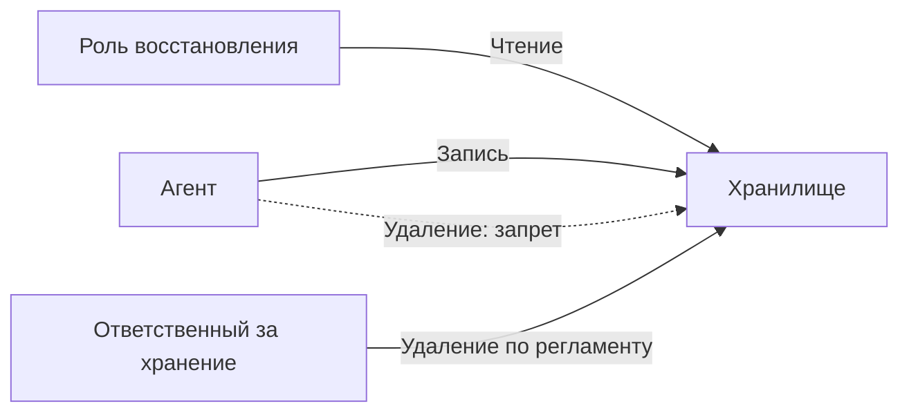
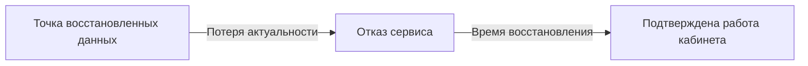

# Лабораторная работа по АБАС

**Тема** — Анализ безопасности резервного копирования и восстановления реестра клуба «В гостях у троллей».

**Дисциплина** — «Анализ безопасности автоматизированных систем» (АБАС).

Подготовил Ижутов Михаил Алексеевич. Материал для старших курсов по информационной безопасности.

[Общий паспорт системы клуба и нормативные основания](../1%20%D1%82%D0%B5%D0%BC%D0%B0/club.md)

## 1. Цель и обоснование

Перед игротекой ведущим нужны актуальные списки и отметки о посещении. При отказе базы важно знать, на какой момент реально восстановить данные и когда ими снова можно пользоваться. Копия содержит те же персональные данные, поэтому доступ к хранилищу и временной базе восстановления тоже входит в область анализа.

Проверить доступ к хранилищу, готовность копий к восстановлению и фактические результаты восстановления реестра. Сопоставить наблюдения с целями клуба по допустимой потере данных и времени возобновления работы.

| Раздел | Блоки |
|---|---|
| I. Обследование системы | Т1–Т2 |
| II. Оценка мер и сбор доказательств | Т3–Т4 |
| III. Проверка результата и подготовка заключения | Т5–Т6 |

## 2. Учебная модель и исходные данные

Сведения условные. Технические выводы делайте по выданным выпискам. Общая архитектура, рабочие допущения и условные идентификаторы приведены в [паспорте клуба](../1%20%D1%82%D0%B5%D0%BC%D0%B0/club.md).

### Д1. Паспорт объекта

Центральная PostgreSQL хранит заявки и отметки о посещении. Сервер резервирования передаёт базовые копии и архив WAL в отдельное хранилище. После условного отказа диска восстанавливают временную БД в изолированном сегменте. В области проверки находятся рабочая БД, архив, сетевые пути записи и чтения, роли хранения, временный экземпляр и протокол проверки кабинета.

Общие исходные данные клуба — 1 200 уникальных совершеннолетних участников, которые не являются работниками оператора. Обрабатываются иные категории ПДн. В учебном паспорте отсутствуют признаки ГИС и объекта КИИ. Первая версия Д1 не содержит типа угроз.

**Д1‑У. Дополнительная вводная.** Учебный оператор определил, что актуальны угрозы третьего типа. Преподаватель предоставляет эту вводную после того, как студенты назовут недостающий параметр для УЗ.

**Поток резервирования и восстановление в отдельном сегменте**

### Л5. Локальные критерии

По Л5 потеря актуальности восстановленных данных не должна превышать 10 минут (RPO), а возобновление проверенной работы кабинета — 90 минут от отказа (RTO). Копии остаются 14 суток по учебному регламенту. Агент может добавлять копии, роль восстановления — читать, удаление выполняет выделенная роль хранения по утверждённому сроку. Канал к хранилищу аутентифицирован, тестовое восстановление выполняют в отдельной зоне с запретом исходящей рассылки.

### Д2. Доступ к резервным копиям

| ID | Проверка | Ожидание Л5 | Результат |
|---|---|---|---|
| B21 | Агент записывает объект в хранилище | Разрешить | Запись выполнена, канал аутентифицирован |
| B22 | Агент пытается удалить тестовый объект в реплике настроек | Запретить | Удаление тестового объекта разрешено |
| B23 | Роль восстановления читает копию | Разрешить | Чтение успешно |
| B24 | Планшет ведущего подключается к хранилищу | Запретить | Сетевой фильтр блокирует |

### Д3. Выписка из каталога и архива WAL

| ID | Элемент | Наблюдение |
|---|---|---|
| C31 | Базовая копия | Доступна, проверка целостности прошла |
| C32 | Архив до 14:45 | Непрерывность WAL от базовой копии подтверждена |
| C33 | Интервал после 14:45 | Промежуточные файлы отсутствуют в доступной цепочке |
| C34 | Файл за 14:50 | Файл присутствует, непрерывность до этой отметки не подтверждена |

Время указано по одной шкале. Для учения используют последнюю подтверждённую точку 14:45. Количество заявок, которых нет в восстановленном состоянии, из временных отметок вычислить нельзя.

### Д4. Шкала восстановления

| Время | Наблюдение |
|---|---|
| 14:45 | Последнее подтверждённое состояние данных |
| 15:00 | Зафиксирован отказ диска и потеря сервиса |
| 15:43 | Запущена восстановленная БД в тестовом сегменте |
| 16:10 | Подтверждена работа кабинета с контрольными записями, выполнена проверка Д5 |

### Д5. Контроль результата и изоляции

| ID | Проверка | Наблюдение |
|---|---|---|
| V51 | Контрольная заявка, зафиксированная до 14:45 | Совпали ID, статус и ID игры |
| V52 | Связь отметки о посещении с записью об игроке | Контрольная связь сохранилась |
| V53 | Открытие списка своей игры и попытка открыть чужую запись | Свой список доступен, чужая запись запрещена |
| V54 | Попытка исходящего соединения со шлюзом рассылки | Фильтр тестового сегмента отклонил соединение |

### Д6. Хранение и контроль

| ID | Возраст копии на момент учения | Состояние |
|---|---|---|
| H61 | 2 суток | Копия присутствует, плановый срок не истёк |
| H62 | 17 суток | Копия присутствует, отдельное основание продления отсутствует |

Инвентарный журнал содержит идентификатор копии и отметки жизненного цикла. Для проверки не нужны поля заявок.

### Схемы к проверкам

**Контроль полномочий в хранилище**

**Измерение восстановления**

## 3. Нормативные основания

Сначала определите режим и УЗ по Н1 и Н2, затем выберите применимые меры по Н3. Сетевые и прикладные значения берите из Л5. Для оценки используйте М1 и М2. Если правовая обязанность зависит от дополнительного условия, укажите это условие в выводе.

| Назначение | Документ | Как применяется |
| --- | --- | --- |
| Н1 | [152‑ФЗ, ст. 5 и ст. 19 ч. 2 п. 7](https://www.consultant.ru/document/cons_doc_LAW_61801/ca9e5658710519f09ab2fdb8196fcb3eb024a051/) | Обосновать срок обработки данных в резервных копиях. Пункт 7 касается восстановления ПДн, изменённых или уничтоженных вследствие несанкционированного доступа. В учебном случае с отказом оборудования сроки задаёт Л5. |
| Н2 | [ПП РФ № 1119, пп. 5–12](https://www.consultant.ru/document/cons_doc_LAW_137356/8c86cf6357879e861790a8a7ca8bea4227d56c72/) | Установить УЗ по категории ПДн, числу и статусу субъектов, типу угроз и конкретному подпункту. По Д1‑У применяется подп. «б» п. 12. |
| Н3 | [Приказ ФСТЭК № 21, пп. 8.2, 8.4, 8.9, 8.10 и 8.13](https://www.consultant.ru/document/cons_doc_LAW_146520/) | Проверить управление доступом, носители, целостность, доступность и защищённость канала. Меры ОДТ.4 и ОДТ.5 можно использовать при обосновании программы защиты и проверок. Для учебного УЗ‑4 условия резервирования заданы Л5. Приложение проверяют по фактическому УЗ и модели угроз. |
| М1 | [NIST SP 800‑34 Rev. 1 и документация PostgreSQL](https://csrc.nist.gov/pubs/sp/800/34/r1/upd1/final) | Использовать определения целей восстановления и метод проверки пригодности базовой копии с архивом WAL. Это методические источники. [Документация PostgreSQL](https://www.postgresql.org/docs/18/continuous-archiving.html) |
| М2 | [ГОСТ Р 56045‑2021](https://protect.gost.ru/gost/details/897416ef-4b50-4c57-aa81-6df5140e7e74) | Подготовить проверку мер по критериям и оформить доказательства, вывод и ограничения выборки. |

Оценка мер показывает результат проверенной выборки. Вопросы аттестации объекта, сертификации СЗИ и гражданско-правовых условий рассмотрены в [реестре применимости](norms.md).

## 4. Знания, умения и задания по блокам

### Т1. Границы ИСПДн и требования клуба

**Знания.** Копии реестра и временный экземпляр содержат ПДн. В область проверки входят связанные роли, хранилища и технические журналы. RPO и RTO задаются потребностью клуба.

**НПА и обоснование.** Н1 включает копии с ПДн в анализ защиты, Н2 задаёт условия УЗ. Целевые параметры процесса фиксирует Л5. [Нормативная база](norms.md)

**Умения.** Нарисовать путь копирования и восстановления, отметить места хранения и включить их в паспорт. После Д1‑У обосновать УЗ.

**Материалы** — Д1 и Д1‑У. **Результат** — паспорт границ и основание для УЗ.

### Т2. Сетевой доступ и полномочия ролей

**Знания.** Разделение ролей уменьшает последствия компрометации. Сетевой маршрут к хранилищу не даёт права удалять копии. Полномочия проверяют на уровне приложения хранилища.

**НПА и обоснование.** Н3 обосновывает управление доступом к хранилищу. Л5 закрепляет разделение записи, чтения и удаления. [Нормативная база](norms.md)

**Умения.** Сверить B21–B24 с Л5 и найти лишнее право. Предложить проверку, которая подтвердит запрет удаления и сохранит плановую запись.

**Материалы** — Д2. **Результат** — матрица ролей и протокол повторной проверки.

### Т3. Пригодность точки восстановления

**Знания.** Базовая копия и непрерывный архив WAL позволяют восстановить БД до заданного момента. Отметка об успешной проверке файла подтверждает целостность этого файла. Достижимость конкретной точки требует подходящей цепочки и проверки восстановления.

**НПА и обоснование.** Н3 связывает проверку с обеспечением целостности и доступности. М1 помогает определить, какие элементы цепочки нужны, а Л5 задаёт критерии приёмки. [Нормативная база](norms.md)

**Умения.** По каталогу определить, до какой точки подтверждена непрерывность. Объяснить, какие данные нужны, чтобы обосновать более позднюю точку.

**Материалы** — Д3. **Результат** — карточка копии и допустимый момент восстановления.

### Т4. RPO и RTO по результатам учения

**Знания.** RPO задаёт допустимую давность восстановленного состояния на момент отказа. RTO ограничивает время до подтверждённого возобновления работы. Конец копирования и старт БД нельзя использовать вместо этих отметок.

**НПА и обоснование.** Н3 задаёт направление защиты доступности. М1 объясняет, как читать показатели, а допустимые значения определяет Л5. [Нормативная база](norms.md)

**Умения.** По шкале Д4 вычислить оба интервала. Для каждого записать измерение, критерий и результат.

**Материалы** — Д4. **Результат** — таблица измерений RPO и RTO.

### Т5. Валидация данных и изоляция

**Знания.** Доступность БД проверяют через функции приложения и контрольные записи. Временный экземпляр содержит копию данных, поэтому исходящие рабочие действия блокируют и подтверждают это проверкой.

**НПА и обоснование.** Н1 и Н3 обосновывают защиту копии с ПДн. Л5 определяет изоляцию временного экземпляра и проверку штатной работы кабинета. [Нормативная база](norms.md)

**Умения.** Сопоставить результаты V51–V54. Показать, какие результаты подтверждают исправную работу кабинета в изолированной среде и как проверить запрет рассылки.

**Материалы** — Д5. **Результат** — акт проверки контрольных записей и изоляции.

### Т6. Срок хранения и вывод по защите

**Знания.** Регламент определяет сроки хранения и ответственного за удаление. Каталог объектов помогает выявить слишком старую копию. При наличии правомерного основания для отдельного хранения его нужно документировать.

**НПА и обоснование.** Н1 задаёт ограничение срока хранения целью обработки. Л5 устанавливает учебный срок и ответственную роль, Н3 и М2 помогают обосновать проверку и её результат. [Нормативная база](norms.md)

**Умения.** Сверить возраст копий с Л5. Выделить меры против лишних полномочий и разрыва архива, затем описать способ повторной проверки и ответственных.

**Материалы** — Д6. **Результат** — заключение с приоритетами и карточкой хранения.

## 5. Подготовка материалов к сдаче

Подготовьте один файл Markdown с паспортом, рабочими таблицами Т1–Т6 и заключением. Схему сохраняйте рядом с текстом. Ссылки на доказательства оформляйте по ID из входных материалов.

| Критерий | Источник и ID | Что наблюдали | Вывод и его граница | Ожидаемый результат повторной проверки |
|---|---|---|---|---|
| Правило или пункт Л5 | Выписка | Фактическое решение или измерение | Риск для процесса клуба | Штатное и запрещённое действие |

## 6. Проверка выполнения

За каждый из пяти признаков можно получить 1 балл. Область и УЗ обоснованы. Критерии связаны с правовыми и локальными основаниями. Доказательства можно найти по ID. Выводы соответствуют границам наблюдений. Повторная проверка учитывает штатный сценарий и отклонение. [Ожидаемые выводы для преподавателя](instructor.md)

## 7. Доклады и публичное представление

Группа выбирает наблюдение, показывает исходные данные и защищает вывод. Аудитория проверяет, можно ли повторить рассуждение по выданным сведениям. [План выступления в Marp](presentation.marp.md)

## 8. Краткие лекции

### 8.1. Границы ИСПДн и требования клуба

Копии реестра и временный экземпляр содержат ПДн. В область проверки входят связанные роли, хранилища и технические журналы. RPO и RTO задаются потребностью клуба.

[Лекция в Markdown для Marp](lectures/01-scope.marp.md)

### 8.2. Сетевой доступ и полномочия ролей

Разделение ролей уменьшает последствия компрометации. Сетевой маршрут к хранилищу не даёт права удалять копии. Полномочия проверяют на уровне приложения хранилища.

[Лекция в Markdown для Marp](lectures/02-review.marp.md)

### 8.3. Пригодность точки восстановления

Базовая копия и непрерывный архив WAL позволяют восстановить БД до заданного момента. Отметка об успешной проверке файла подтверждает целостность этого файла. Достижимость конкретной точки требует подходящей цепочки и проверки восстановления.

[Лекция в Markdown для Marp](lectures/03-evidence.marp.md)

### 8.4. RPO и RTO по результатам учения

RPO задаёт допустимую давность восстановленного состояния на момент отказа. RTO ограничивает время до подтверждённого возобновления работы. Конец копирования и старт БД нельзя использовать вместо этих отметок.

[Лекция в Markdown для Marp](lectures/04-analysis.marp.md)

### 8.5. Валидация данных и изоляция

Доступность БД проверяют через функции приложения и контрольные записи. Временный экземпляр содержит копию данных, поэтому исходящие рабочие действия блокируют и подтверждают это проверкой.

[Лекция в Markdown для Marp](lectures/05-control.marp.md)

### 8.6. Срок хранения и вывод по защите

Регламент определяет сроки хранения и ответственного за удаление. Каталог объектов помогает выявить слишком старую копию. При наличии правомерного основания для отдельного хранения его нужно документировать.

[Лекция в Markdown для Marp](lectures/06-conclusion.marp.md)

## 9. Сквозное практическое задание

**Задание.** Подготовьте заключение о проверенном процессе клуба. Опишите зависимость между участками системы, выберите существенные отклонения и составьте последовательность действий для их устранения.

1. По Д1 и Д1‑У определите состав системы и УЗ.
2. Для Т2–Т6 выпишите критерий из Л5, найдите связанные выписки и запишите наблюдаемый результат.
3. Для каждого отклонения укажите возможное последствие. Если наблюдения недостаточно, назовите недостающий источник.
4. Предложите повторные проверки и зафиксируйте, при каких наблюдениях защиту можно считать восстановленной на этой выборке.

## 10. Итоговый экзамен

За каждый правильный ответ в части А — 1 балл. В части Б каждое из четырёх заданий оценивается в 2 балла. Зачёт — от 12 из 20 баллов, включая минимум 4 из 8 за кейс.

### 10.1. Часть А. Тест на 12 баллов

| № | Вопрос | А | Б | В |
| --- | --- | --- | --- | --- |
| 1 | Какие компоненты учитывают в границах? | Только публичный сайт | Только рабочий интерфейс | Копии, хранилище и временную БД с ПДн |
| 2 | Что означает целевой RPO? | Максимально допустимая потеря актуальности данных | Число файлов архива | Срок хранения копии |
| 3 | Как вычисляют фактическое время восстановления в кейсе? | От первой записи WAL до начала отказа | От отказа до подтверждённой работы кабинета | От старта БД до создания копии |
| 4 | Что доказывает B22? | У роли агента есть избыточное право удаления | Истёк срок хранения каждой копии | Оператор удалил рабочие заявки |
| 5 | Зачем проверять непрерывность WAL? | Чтобы определить версию браузера | Чтобы изменить УЗ | Чтобы обосновать достижимость требуемой точки восстановления |
| 6 | Что требуется для проверки V53? | Только хеш копии | Штатный и запрещённый запрос приложения | Только старт базы |
| 7 | С чем сравнить время 70 минут? | Со сроком хранения | С числом участников | С целевым RTO |
| 8 | Какое значение получено для потери актуальности по Д4? | 15 минут | 70 минут | 10 минут |
| 9 | Почему временный сегмент блокирует рассылку? | Чтобы изменить часовой пояс | Чтобы восстановленный экземпляр не отправлял реальные уведомления | Чтобы удалить журнал |
| 10 | Что фиксируют в акте восстановления? | Текст каждой заявки | Критерий, отметки времени и результаты контроля данных | Только имя архива |
| 11 | Что видно по H62? | Истёк локальный срок хранения, исключение отсутствует | Утеряны все свежие копии | Тип угроз изменился |
| 12 | Что проверить при запросе более поздней точки, чем 14:45? | Только место на диске | Только успешный вход в CRM | Непрерывность архива после 14:45 и результат контролируемого восстановления |

### 10.2. Часть Б. Практический кейс на 8 баллов

В новом учении база перестала отвечать в 18:10. Последнее подтверждённое восстановленное состояние — 18:03. Проверка кабинета в отдельной зоне завершилась в 19:55. Цели Л5 сохраняются. Инвентарный журнал подтверждает наличие свежей копии, но приложение хранилища разрешает планировщику удалить тестовый объект. В сети восстановления исходящие уведомления отклоняются, проверка контрольной заявки и списка своей игры выполнена.

1. Вычислить потерю актуальности и оценить результат по RPO.
2. Вычислить время восстановления и оценить результат по RTO.
3. Найти отклонение в правах и указать две проверки после исправления.
4. Назвать доказательства пригодности восстановления и их предел.

## 11. Обмен материалами, доклады и мини-мастер-классы

| Блок | Доклад | Мини-мастер-класс | Передаваемый материал |
| --- | --- | --- | --- |
| Т1. Границы ИСПДн и требования клуба | Что относится к области проверки | Объяснить границу и назвать один недостающий вход для вывода | Паспорт границ и основание для УЗ. |
| Т2. Сетевой доступ и полномочия ролей | Как проверить локальный критерий | Сопоставить выписку и целевое правило | Матрица ролей и протокол повторной проверки. |
| Т3. Пригодность точки восстановления | Какие источники нужно связать | Показать вывод на двух записях или проверках | Карточка копии и допустимый момент восстановления. |
| Т4. RPO и RTO по результатам учения | Как обосновать предел вывода | Записать наблюдение и условие, которое требует отдельного подтверждения | Таблица измерений RPO и RTO. |
| Т5. Валидация данных и изоляция | Как сохранить штатную работу | Парой контрольных сценариев проверить разрешённое и запрещённое действие | Акт проверки контрольных записей и изоляции. |
| Т6. Срок хранения и вывод по защите | Как оформлять повторную проверку | Заполнить одну строку программы и объяснить ожидаемый результат | Заключение с приоритетами и карточкой хранения. |

Передайте другой группе один артефакт с ID наблюдения и сформулированным критерием. Получатель проверяет вывод и возвращает одно замечание, привязанное к выданному материалу. [Отдельный план обмена](exchange.md)

## 12. Публичное изложение темы

[Отдельная презентация из 10 слайдов](presentation.marp.md)

### 12.1. Защита резервных копий реестра

Клуб настольных игр «В гостях у троллей»

Дисциплина «Анализ безопасности автоматизированных систем»

Ижутов Михаил Алексеевич

**Заметка докладчику.** Назовите процесс клуба и объясните, что студент должен подтвердить по результатам проверки.

### 12.2. Зачем клубу проверка восстановления

Игротеки зависят от актуальных заявок и отметок посещения. Перед возобновлением работы проверяют состояние данных и функции кабинета.

**Заметка докладчику.** Свяжите допустимую потерю данных с последствиями для ближайшей игры.

### 12.3. Что входит в область

Рабочая БД, архив WAL, отдельное хранилище, временная БД, журнал и кабинет ведущего.

**Заметка докладчику.** Покажите путь копии и выделите границу тестового сегмента.

### 12.4. Нормативные основания

Статья 19 152‑ФЗ и приказ ФСТЭК № 21 задают рамки защиты. Цели восстановления и срок хранения задаёт регламент Л5.

**Заметка докладчику.** Укажите, почему цифры привязаны к потребностям клуба.

### 12.5. Доступ к хранилищу

Агент записывает копии, роль восстановления читает, выделенная роль удаляет по регламенту.

**Заметка докладчику.** Попросите назвать штатный и запрещённый сценарии агента.

### 12.6. Пригодность точки восстановления

Подтверждаем наличие базовой копии и непрерывность архива WAL. Контрольные данные проверяем через кабинет.

**Заметка докладчику.** Используйте таблицу каталога, чтобы объяснить разрыв архива.

### 12.7. Измерение RPO и RTO

Потерю актуальности считаем от восстановленной точки до отказа. Время восстановления — от отказа до подтверждённой работы.

**Заметка докладчику.** Покажите, почему запуск БД — промежуточное событие.

### 12.8. Практический результат

Матрица ролей, расчёт RPO и RTO, акт контрольных проверок и план обновления защиты копий.

**Заметка докладчику.** Разберите один вывод по данным учения.

### 12.9. Обмен материалами

Группы сверяют расчёты, пределы контрольной выборки и план проверки изоляции.

**Заметка докладчику.** Попросите аудиторию отметить, где полезны положительные и отрицательные сценарии.

### 12.10. Экзамен

12 вопросов и новый вариант восстановления. За практическую часть требуется не менее 4 из 8 баллов.

**Заметка докладчику.** Напомните, что результаты сравнивают с Л5.
