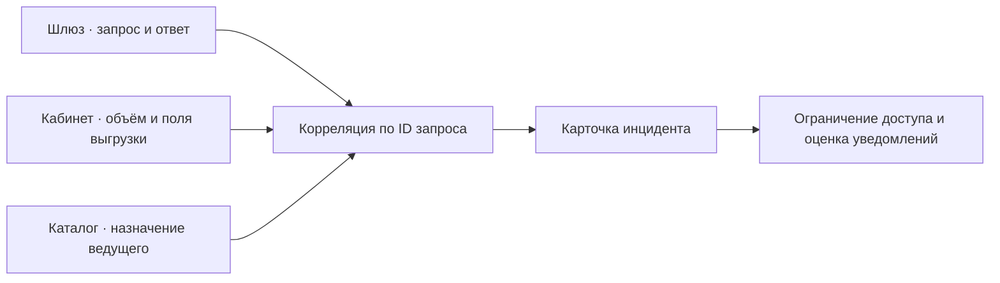
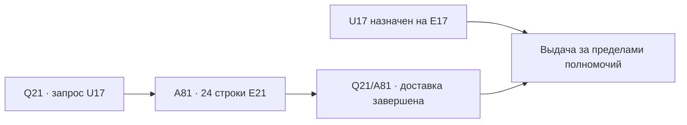
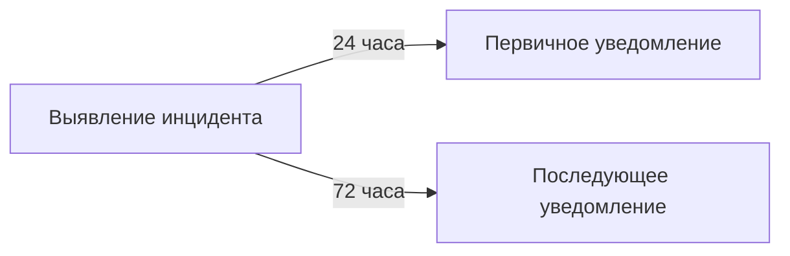

# Учебный кейс. Расследование выдачи списка участников

Все материалы условные. Используйте [общий паспорт клуба](../1%20%D1%82%D0%B5%D0%BC%D0%B0/club.md) и выданные в этом файле выписки. Для определения УЗ сначала прочитайте Д1, затем получите Д1‑У.

## Д1. Паспорт объекта

Кабинет ведущего формирует ограниченную выгрузку из реестра клуба. Пользователь U17 назначен на игру E17, а E21 закреплена за другим ведущим. Во время настройки модуля выгрузки обнаружена выдача чужого списка. В анализ входят шлюз, каталог назначений, журнал приложения, запись фактической доставки и материалы дежурного. Время в таблицах относится к учебному дню 12 ноября и приводится вместе с часовым поясом.

Общие исходные данные клуба — 1 200 уникальных совершеннолетних участников, которые не являются работниками оператора. Обрабатываются иные категории ПДн. В учебном паспорте отсутствуют признаки ГИС и объекта КИИ. Первая версия Д1 не содержит типа угроз.

**Д1‑У. Дополнительная вводная.** Учебный оператор определил, что актуальны угрозы третьего типа. Преподаватель предоставляет эту вводную после того, как студенты назовут недостающий параметр для УЗ.

**Источники доказательств и решение об инциденте**

## Л6. Локальные критерии

Л6 разрешает ведущему создавать служебную выгрузку только для назначенной игры. Дежурный связывает события по идентификатору запроса, времени и ID выгрузки. В учебный протокол включают только категории полей, число записей, обезличенные ID и исходные отметки времени. Действия с правами, фиксацию выписок и решение об эскалации регистрируют в карточке инцидента.

## Д2. Назначения и состав выгрузки

| ID | Учётная запись | Назначение | Разрешено по Л6 |
|---|---|---|---|
| A21 | U17, ведущий | E17 | Служебный список E17 |
| A22 | U21, ведущий | E21 | Служебный список E21 |

Список включает имя и телефон участника. ID игры и пользователя используются в журнале для подтверждения области доступа.

## Д3. Выписки шлюза и кабинета

| ID | Время | Источник | Наблюдение |
|---|---|---|---|
| X31 | 14:50:00 UTC | Шлюз | Запрос Q21 от U17 завершён с ответом 200 |
| X32 | 17:50:00 UTC+3 | Кабинет | Q21 сформировал файл A81 для E21, 24 строки, поля «имя» и «телефон» |
| X33 | 17:50:01 UTC+3 | Шлюз | Передача Q21/A81 сеансу U17 завершилась полностью |
| X34 | 17:52:00 UTC+3 | Шлюз | Запрос Q22 завершён отказом 403, выгрузки нет |

Идентификаторы Q21 и A81 в выписках принадлежат одной операции. В открываемых документах клуба на занятии нет значений полей выгрузки.

## Д4. Сдерживание и сохранение доказательств

| ID | Действие | Условие приёмки |
|---|---|---|
| R41 | Ответственный сохраняет выписки шлюза, кабинета и каталога | У каждого материала есть источник, время сохранения и ответственный |
| R42 | Администратор временно выключает выгрузки ведущих | Просмотр списков назначенных игр продолжает работать |
| R43 | Ответственный регистрирует объём и возможное влияние | В карточке 24 записи E21, категории полей и известные факты |
| R44 | Группа проверяет исправленный контроль назначения | Сценарии Д6 проверены перед возвратом функции |

## Д5. Установление инцидента и сроки

В 17:53 сигнал мониторинга указал необычный объём выгрузки. Сам сигнал не содержал сведений о владельце мероприятия и составе файла. В 18:20 UTC+3 12 ноября оператор сопоставил данные, впервые выявил неправомерное предоставление имён и телефонов лицу без полномочий на список и установил нарушение прав субъектов на конфиденциальность. По условиям упражнения нет сведений о более раннем выявлении инцидента оператором, Роскомнадзором или иным заинтересованным лицом. Время обнаружения инцидента задано входными материалами.

Подготовьте черновики для 24 и 72 часов. В первичном укажите факт, предполагаемые причины и вред, принятые меры и уполномоченный контакт. В последующем укажите результаты внутреннего расследования и сведения о лицах, действия которых стали причиной инцидента, если они установлены. В черновиках используйте условные реквизиты.

## Д6. Проверки после исправления

| ID | Проверка | Наблюдение |
|---|---|---|
| T61 | U17 запрашивает выгрузку E17 | Выгрузка своей игры сформирована и доставлена |
| T62 | U17 запрашивает выгрузку E21 | Отказ до формирования файла |
| T63 | Запись о запрете T62 | Запись есть, но поля с ID запроса нет |

Л6 требует связь решения с идентификатором запроса. Поля заявок в записи журнала отсутствуют.

## Схемы к проверкам

**Установление факта выдачи**

**Отсчёт сроков уведомления**

