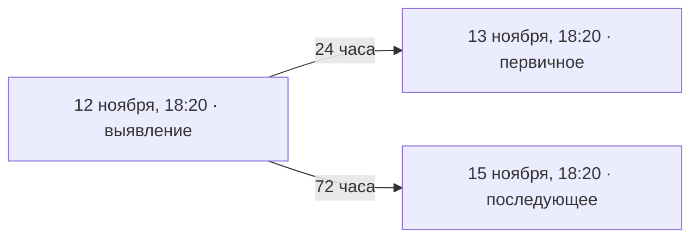

# Материалы преподавателя. Расследование выдачи списка участников

Сначала выдайте Д1. Откройте Д1‑У после того, как студенты зафиксируют отсутствие типа угроз. При проверке обращайте внимание на связку критерия и конкретного наблюдения. [Учебный кейс](case.md) · [Экзамен](exam.md)

## Ожидаемые выводы практики

| Блок | Ожидаемые выводы |
| --- | --- |
| Т1 | УЗ‑4 по подп. «б» п. 12. U17 назначен только на E17. Выдачу E21 проверяют отдельно по Д3. |
| Т2 | X31–X33 связываются через Q21 и A81. 14:50 UTC соответствует 17:50 UTC+3. X34 относится к Q22 и завершён отказом. |
| Т3 | По X32–X33 доставлены 24 строки с именем и телефоном E21. По Д2 у U17 права на E21 отсутствуют. Доказательств дальнейшего распространения нет. |
| Т4 | Сохраняются выписки и справка о назначении. Временно отключается выгрузка для ведущих, штатный просмотр своей игры остаётся. Возврат после проверки Д6. |
| Т5 | Выявление 12 ноября 18:20. Пределы — 13 ноября 18:20 и 15 ноября 18:20 UTC+3. Второе уведомление содержит результаты расследования и сведения о лицах, действия которых стали причиной инцидента, при наличии. |
| Т6 | Доступ к чужой выгрузке закрыт, штатная выдача работает. По T63 запись журнала неполная, отсутствует ID запроса. Проверить сквозную корреляцию после исправления. |

**Сроки в учебном сценарии**

## Ключ теста

| Вопрос | 1 | 2 | 3 | 4 | 5 | 6 | 7 | 8 | 9 | 10 | 11 | 12 |
| --- | --- | --- | --- | --- | --- | --- | --- | --- | --- | --- | --- | --- |
| Ответ | А | Б | В | Б | А | В | В | А | Б | В | Б | А |

## Проверка кейса

| Задание | Два балла за полный ответ |
| --- | --- |
| 1 | Z10 и A92 связывают приложение и шлюз. Матрица назначений подтверждает запрет. Выданы имя и телефон в 12 строках. |
| 2 | Дальнейшее распространение не установлено. Ограничить проблемную выгрузку, сохранить журнал и выписку назначений. |
| 3 | До 20 ноября 11:40 и 22 ноября 11:40 UTC+3 по ч. 3.1 ст. 21. |
| 4 | Своя игра выдаётся, чужая блокируется до создания файла. Отказ отражён в журнале с ID запроса. |

За неполный обоснованный ответ поставьте 1 балл. Ответ без результата или с ошибочным итоговым выводом получает 0. Зачёт — от 12 из 20 баллов, включая минимум 4 балла за кейс.
