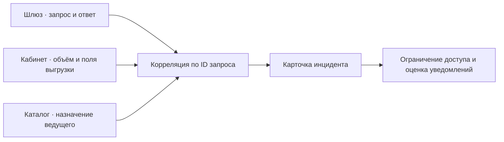
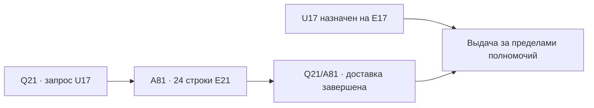
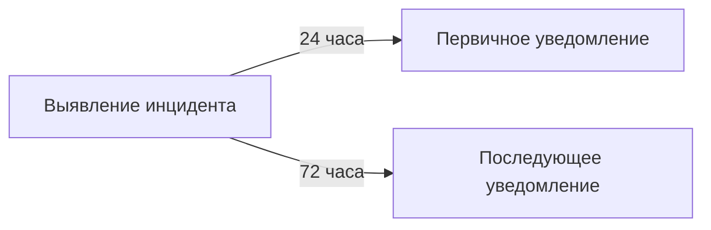

# Лабораторная работа по АБАС

**Тема** — Анализ журналов и реагирование на неправомерную выдачу списка участников клуба «В гостях у троллей».

**Дисциплина** — «Анализ безопасности автоматизированных систем» (АБАС).

Подготовил Ижутов Михаил Алексеевич. Материал для старших курсов по информационной безопасности.

[Общий паспорт системы клуба и нормативные основания](../1%20%D1%82%D0%B5%D0%BC%D0%B0/club.md)

## 1. Цель и обоснование

Ведущий должен видеть записи только назначенного мероприятия. Если кабинет отдал ему чужой список, оператору нужно установить факт и объём выдачи по нескольким источникам, ограничить дальнейший доступ и решить, какие уведомления требуются. Один сетевой ответ или сигнал мониторинга для такого решения недостаточен.

Восстановить хронологию по журналам кабинета и шлюза, обосновать, какие данные получил пользователь, выбрать меры сдерживания и подготовить материалы для условного расследования.

| Раздел | Блоки |
|---|---|
| I. Обследование системы | Т1–Т2 |
| II. Оценка мер и сбор доказательств | Т3–Т4 |
| III. Проверка результата и подготовка заключения | Т5–Т6 |

## 2. Учебная модель и исходные данные

Сведения условные. Технические выводы делайте по выданным выпискам. Общая архитектура, рабочие допущения и условные идентификаторы приведены в [паспорте клуба](../1%20%D1%82%D0%B5%D0%BC%D0%B0/club.md).

### Д1. Паспорт объекта

Кабинет ведущего формирует ограниченную выгрузку из реестра клуба. Пользователь U17 назначен на игру E17, а E21 закреплена за другим ведущим. Во время настройки модуля выгрузки обнаружена выдача чужого списка. В анализ входят шлюз, каталог назначений, журнал приложения, запись фактической доставки и материалы дежурного. Время в таблицах относится к учебному дню 12 ноября и приводится вместе с часовым поясом.

Общие исходные данные клуба — 1 200 уникальных совершеннолетних участников, которые не являются работниками оператора. Обрабатываются иные категории ПДн. В учебном паспорте отсутствуют признаки ГИС и объекта КИИ. Первая версия Д1 не содержит типа угроз.

**Д1‑У. Дополнительная вводная.** Учебный оператор определил, что актуальны угрозы третьего типа. Преподаватель предоставляет эту вводную после того, как студенты назовут недостающий параметр для УЗ.

**Источники доказательств и решение об инциденте**

### Л6. Локальные критерии

Л6 разрешает ведущему создавать служебную выгрузку только для назначенной игры. Дежурный связывает события по идентификатору запроса, времени и ID выгрузки. В учебный протокол включают только категории полей, число записей, обезличенные ID и исходные отметки времени. Действия с правами, фиксацию выписок и решение об эскалации регистрируют в карточке инцидента.

### Д2. Назначения и состав выгрузки

| ID | Учётная запись | Назначение | Разрешено по Л6 |
|---|---|---|---|
| A21 | U17, ведущий | E17 | Служебный список E17 |
| A22 | U21, ведущий | E21 | Служебный список E21 |

Список включает имя и телефон участника. ID игры и пользователя используются в журнале для подтверждения области доступа.

### Д3. Выписки шлюза и кабинета

| ID | Время | Источник | Наблюдение |
|---|---|---|---|
| X31 | 14:50:00 UTC | Шлюз | Запрос Q21 от U17 завершён с ответом 200 |
| X32 | 17:50:00 UTC+3 | Кабинет | Q21 сформировал файл A81 для E21, 24 строки, поля «имя» и «телефон» |
| X33 | 17:50:01 UTC+3 | Шлюз | Передача Q21/A81 сеансу U17 завершилась полностью |
| X34 | 17:52:00 UTC+3 | Шлюз | Запрос Q22 завершён отказом 403, выгрузки нет |

Идентификаторы Q21 и A81 в выписках принадлежат одной операции. В открываемых документах клуба на занятии нет значений полей выгрузки.

### Д4. Сдерживание и сохранение доказательств

| ID | Действие | Условие приёмки |
|---|---|---|
| R41 | Ответственный сохраняет выписки шлюза, кабинета и каталога | У каждого материала есть источник, время сохранения и ответственный |
| R42 | Администратор временно выключает выгрузки ведущих | Просмотр списков назначенных игр продолжает работать |
| R43 | Ответственный регистрирует объём и возможное влияние | В карточке 24 записи E21, категории полей и известные факты |
| R44 | Группа проверяет исправленный контроль назначения | Сценарии Д6 проверены перед возвратом функции |

### Д5. Установление инцидента и сроки

В 17:53 сигнал мониторинга указал необычный объём выгрузки. Сам сигнал не содержал сведений о владельце мероприятия и составе файла. В 18:20 UTC+3 12 ноября оператор сопоставил данные, впервые выявил неправомерное предоставление имён и телефонов лицу без полномочий на список и установил нарушение прав субъектов на конфиденциальность. По условиям упражнения нет сведений о более раннем выявлении инцидента оператором, Роскомнадзором или иным заинтересованным лицом. Время обнаружения инцидента задано входными материалами.

Подготовьте черновики для 24 и 72 часов. В первичном укажите факт, предполагаемые причины и вред, принятые меры и уполномоченный контакт. В последующем укажите результаты внутреннего расследования и сведения о лицах, действия которых стали причиной инцидента, если они установлены. В черновиках используйте условные реквизиты.

### Д6. Проверки после исправления

| ID | Проверка | Наблюдение |
|---|---|---|
| T61 | U17 запрашивает выгрузку E17 | Выгрузка своей игры сформирована и доставлена |
| T62 | U17 запрашивает выгрузку E21 | Отказ до формирования файла |
| T63 | Запись о запрете T62 | Запись есть, но поля с ID запроса нет |

Л6 требует связь решения с идентификатором запроса. Поля заявок в записи журнала отсутствуют.

### Схемы к проверкам

**Установление факта выдачи**

**Отсчёт сроков уведомления**

## 3. Нормативные основания

Сначала определите режим и УЗ по Н1 и Н2, затем выберите применимые меры по Н3. Сетевые и прикладные значения берите из Л6. Для оценки используйте М1 и М2. Если правовая обязанность зависит от дополнительного условия, укажите это условие в выводе.

| Назначение | Документ | Как применяется |
| --- | --- | --- |
| Н1 | [152‑ФЗ, ст. 7, ст. 19 и ст. 21 ч. 3.1](https://www.consultant.ru/document/cons_doc_LAW_61801/d3fe43a7c415353b17faab255bc0de92bea127da/) | Проверить режим конфиденциальности, обнаружение и регистрацию событий, действия при установленной неправомерной либо случайной передаче ПДн, повлёкшей нарушение прав субъектов. При наличии условий применяются сроки 24 и 72 часа от выявления инцидента. |
| Н2 | [ПП РФ № 1119, пп. 5–12](https://www.consultant.ru/document/cons_doc_LAW_137356/8c86cf6357879e861790a8a7ca8bea4227d56c72/) | Установить УЗ по категории ПДн, числу и статусу субъектов, типу угроз и конкретному подпункту. По Д1‑У применяется подп. «б» п. 12. |
| Н3 | [Приказ ФСТЭК № 21, пп. 8.2, 8.5 и 8.14](https://www.consultant.ru/document/cons_doc_LAW_146520/) | Проверить управление доступом, регистрацию событий, обнаружение и реагирование. Состав мер обосновать по УЗ, угрозам и архитектуре. |
| Н4 | [Приказ Роскомнадзора от 14.11.2022 № 187](https://publication.pravo.gov.ru/Document/View/0001202212280052) | Определить, какие сведения оператор указывает в первичном и последующем уведомлениях о подтверждённом инциденте в области ПДн. [Текст приказа](https://www.consultant.ru/document/cons_doc_LAW_435840/) |
| М1 | [ISO/IEC 27035‑1:2023](https://www.iso.org/standard/78973.html) | Использовать стадии обнаружения, оценки, реагирования и разбора причин для структуры расследования. |
| М2 | [ГОСТ Р 56045‑2021](https://protect.gost.ru/gost/details/897416ef-4b50-4c57-aa81-6df5140e7e74) | Подготовить проверку мер по критериям и оформить доказательства, вывод и ограничения выборки. |

Оценка мер показывает результат проверенной выборки. Вопросы аттестации объекта, сертификации СЗИ и гражданско-правовых условий рассмотрены в [реестре применимости](norms.md).

## 4. Знания, умения и задания по блокам

### Т1. Активы, границы и критерий инцидента

**Знания.** Событие безопасности может потребовать анализа. Для вывода об инциденте указывают данные, действие, право получателя и последствия. Уровень ИСПДн определяют по паспорту и угрозам.

**НПА и обоснование.** Н1 и Н2 задают режим защиты, условия определения УЗ и правовой критерий инцидента. Л6 описывает, кому разрешено получить список. [Нормативная база](norms.md)

**Умения.** Описать границы процесса выгрузки и требование к правам ведущего. Применить Д1‑У. В списке входов указать, чем подтверждается нарушение назначения.

**Материалы** — Д1, Д1‑У и Д2. **Результат** — паспорт и правило принятия решения.

### Т2. Корреляция журналов и времени

**Знания.** Журналы шлюза и кабинета фиксируют разные действия. Их связывают устойчивыми идентификаторами и приводят время к одной зоне. Код HTTP 200 сам по себе не раскрывает содержание ответа.

**НПА и обоснование.** Н3 обосновывает регистрацию событий и реагирование. М1 задаёт этапы оценки, а Л6 предписывает связывать журналы по ID. [Нормативная база](norms.md)

**Умения.** Связать X31–X33. Привести UTC к UTC+3. Выделить X34 как отдельное событие и объяснить, почему оно не меняет вывод по Q21.

**Материалы** — Д3. **Результат** — шкала событий с источниками.

### Т3. Факт выдачи и границы вывода

**Знания.** Факт формирования файла и факт его доставки различаются. В сочетании с матрицей назначений и данными о содержании подтверждённая доставка позволяет установить выдачу чужого списка. Дальнейшее распространение требует других доказательств.

**НПА и обоснование.** Н1 задаёт требования к конфиденциальности, Н3 связывает вывод с контролем доступа и регистрацией. Критерий полномочий берут из Л6. [Нормативная база](norms.md)

**Умения.** Составить карточку подтверждённого факта с объёмом и категориями полей. Отдельно записать вопрос о дальнейшей передаче.

**Материалы** — Д2 и Д3. **Результат** — карточка инцидента с границами вывода.

### Т4. Сдерживание и сохранение материалов

**Знания.** После обнаружения ограничивают воспроизведение нарушения и сохраняют доступные наблюдения. Выписки фиксируют с источником, временем и ответственным. Включать действительные контакты участников в отчёт занятия не требуется.

**НПА и обоснование.** Н1 и Н3 обосновывают меры защиты и реагирования. М1 помогает построить порядок действий, а Л6 определяет состав карточки и выписок. [Нормативная база](norms.md)

**Умения.** Из Д4 собрать порядок действий, назначения ответственных и список сохранённых материалов. Сформулировать условия возврата выгрузки.

**Материалы** — Д4. **Результат** — план реагирования и реестр доказательств.

### Т5. Первичное и последующее уведомления

**Знания.** Обязанность уведомить Роскомнадзор по ч. 3.1 ст. 21 возникает при установленном законом факте передачи, предоставления, распространения или доступа и нарушении прав субъектов. Сроки первичного и последующего уведомлений считают от выявления такого инцидента.

**НПА и обоснование.** Н1 задаёт условие и сроки уведомлений. Н4 определяет порядок взаимодействия с Роскомнадзором и состав сведений. [Нормативная база](norms.md)

**Умения.** По Д5 объяснить, почему обязанность возникает в сценарии. Рассчитать обе отметки, перечислить сведения для двух черновиков. Указать открытые вопросы расследования.

**Материалы** — Д5. **Результат** — два учебных черновика без фактической отправки.

### Т6. Повторная проверка и улучшение контроля

**Знания.** Исправление проверяют положительным и отрицательным сценариями через тот же интерфейс. Отказ для чужого списка должен быть до формирования файла. Журнал фиксирует решение без вывода контактов.

**НПА и обоснование.** Н3 обосновывает проверку ограничения доступа и регистрации отказов. Л6 определяет поля журнала, М1 и М2 помогают оформить подтверждение исправления. [Нормативная база](norms.md)

**Умения.** Оценить T61–T63, определить, устранена ли выдача на учебной выборке и какое отклонение осталось. Предложить дополнительное наблюдение по регистрации отказа.

**Материалы** — Д6. **Результат** — заключение и план проверки журналирования.

## 5. Подготовка материалов к сдаче

Подготовьте один файл Markdown с паспортом, рабочими таблицами Т1–Т6 и заключением. Схему сохраняйте рядом с текстом. Ссылки на доказательства оформляйте по ID из входных материалов.

| Критерий | Источник и ID | Что наблюдали | Вывод и его граница | Ожидаемый результат повторной проверки |
|---|---|---|---|---|
| Правило или пункт Л6 | Выписка | Фактическое решение или измерение | Риск для процесса клуба | Штатное и запрещённое действие |

## 6. Проверка выполнения

За каждый из пяти признаков можно получить 1 балл. Область и УЗ обоснованы. Критерии связаны с правовыми и локальными основаниями. Доказательства можно найти по ID. Выводы соответствуют границам наблюдений. Повторная проверка учитывает штатный сценарий и отклонение. [Ожидаемые выводы для преподавателя](instructor.md)

## 7. Доклады и публичное представление

Группа выбирает наблюдение, показывает исходные данные и защищает вывод. Аудитория проверяет, можно ли повторить рассуждение по выданным сведениям. [План выступления в Marp](presentation.marp.md)

## 8. Краткие лекции

### 8.1. Активы, границы и критерий инцидента

Событие безопасности может потребовать анализа. Для вывода об инциденте указывают данные, действие, право получателя и последствия. Уровень ИСПДн определяют по паспорту и угрозам.

[Лекция в Markdown для Marp](lectures/01-scope.marp.md)

### 8.2. Корреляция журналов и времени

Журналы шлюза и кабинета фиксируют разные действия. Их связывают устойчивыми идентификаторами и приводят время к одной зоне. Код HTTP 200 сам по себе не раскрывает содержание ответа.

[Лекция в Markdown для Marp](lectures/02-review.marp.md)

### 8.3. Факт выдачи и границы вывода

Факт формирования файла и факт его доставки различаются. В сочетании с матрицей назначений и данными о содержании подтверждённая доставка позволяет установить выдачу чужого списка. Дальнейшее распространение требует других доказательств.

[Лекция в Markdown для Marp](lectures/03-evidence.marp.md)

### 8.4. Сдерживание и сохранение материалов

После обнаружения ограничивают воспроизведение нарушения и сохраняют доступные наблюдения. Выписки фиксируют с источником, временем и ответственным. Включать действительные контакты участников в отчёт занятия не требуется.

[Лекция в Markdown для Marp](lectures/04-analysis.marp.md)

### 8.5. Первичное и последующее уведомления

Обязанность уведомить Роскомнадзор по ч. 3.1 ст. 21 возникает при установленном законом факте передачи, предоставления, распространения или доступа и нарушении прав субъектов. Сроки первичного и последующего уведомлений считают от выявления такого инцидента.

[Лекция в Markdown для Marp](lectures/05-control.marp.md)

### 8.6. Повторная проверка и улучшение контроля

Исправление проверяют положительным и отрицательным сценариями через тот же интерфейс. Отказ для чужого списка должен быть до формирования файла. Журнал фиксирует решение без вывода контактов.

[Лекция в Markdown для Marp](lectures/06-conclusion.marp.md)

## 9. Сквозное практическое задание

**Задание.** Подготовьте заключение о проверенном процессе клуба. Опишите зависимость между участками системы, выберите существенные отклонения и составьте последовательность действий для их устранения.

1. По Д1 и Д1‑У определите состав системы и УЗ.
2. Для Т2–Т6 выпишите критерий из Л6, найдите связанные выписки и запишите наблюдаемый результат.
3. Для каждого отклонения укажите возможное последствие. Если наблюдения недостаточно, назовите недостающий источник.
4. Предложите повторные проверки и зафиксируйте, при каких наблюдениях защиту можно считать восстановленной на этой выборке.

## 10. Итоговый экзамен

За каждый правильный ответ в части А — 1 балл. В части Б каждое из четырёх заданий оценивается в 2 балла. Зачёт — от 12 из 20 баллов, включая минимум 4 из 8 за кейс.

### 10.1. Часть А. Тест на 12 баллов

| № | Вопрос | А | Б | В |
| --- | --- | --- | --- | --- |
| 1 | Что подтверждает факт доставки файла? | Запись шлюза о завершённой передаче с совпавшим ID файла | Список ролей без событий | Срабатывание общего порога |
| 2 | Зачем приводить UTC и UTC+3 к общей шкале? | Чтобы изменить полномочия | Чтобы сопоставить записи по времени | Чтобы отбросить ID запросов |
| 3 | Какие наблюдения дают состав и объём выгрузки? | Только запись о подключении VPN | Только HTTP-статус | Журнал формирования файла с ID и составом полей |
| 4 | Как доказать отсутствие назначения U17 на E21? | Увидеть код 200 | Сопоставить запрос и действовавшую матрицу назначений | Сравнить имена журналов |
| 5 | Когда в кейсе начинается отсчёт для уведомлений? | При выявлении установленного инцидента в 18:20 | После включения выгрузки | При установке кабинета |
| 6 | Что передают в рамках последующего уведомления? | Копии всех таблиц | Снимок настроек Wi-Fi | Результаты расследования и сведения о причинивших инцидент лицах при наличии |
| 7 | Как сдержать повторную выдачу по сценарию Д4? | Заблокировать только публичную страницу | Удалить журнал кабинета | Ограничить выгрузку и сохранить штатный просмотр |
| 8 | Что означает возможность дальнейшей пересылки файла? | Её нужно проверять отдельными доказательствами | Она доказана выдачей файла | Она автоматически отменяет уведомление |
| 9 | Через какой срок направляется первичное уведомление? | После утверждения годового отчёта | В течение 24 часов от выявления инцидента | До 72 часов от завершения расследования |
| 10 | Как оформить сохранённую выписку? | Вставить имена и телефоны всех участников | Заменить журнал пересказом без номера | Указать источник, время и ответственного |
| 11 | Что показывает T62? | Все журналы полны | Выдача чужого списка пресечена до создания файла | Расследование завершено |
| 12 | Что доработать после T63? | Регистрацию ID запроса для корреляции отказа | Наименование игротеки | Форму записи игрока |

### 10.2. Часть Б. Практический кейс на 8 баллов

В альтернативном учении 19 ноября в 11:40 UTC+3 оператор выявил и документировал неправомерную выдачу списка, повлёкшую нарушение прав его участников. Запрос Z10 сделал U32, уполномоченный только на игру E32. Журнал приложения связал Z10 с файлом A92 другой игры E40 и 12 строками с именем и телефоном. Журнал шлюза подтвердил полную доставку A92 сеансу U32. Ранее был сигнал об объёме ответа, иного выявления инцидента по вводной не было. Данных о дальнейшей пересылке нет.

1. Назвать и связать доказательства с выводом о выдаче.
2. Описать границу вывода и первичные действия.
3. Рассчитать предельные отметки обоих уведомлений.
4. Назвать доказательства успешного исправления.

## 11. Обмен материалами, доклады и мини-мастер-классы

| Блок | Доклад | Мини-мастер-класс | Передаваемый материал |
| --- | --- | --- | --- |
| Т1. Активы, границы и критерий инцидента | Что относится к области проверки | Объяснить границу и назвать один недостающий вход для вывода | Паспорт и правило принятия решения. |
| Т2. Корреляция журналов и времени | Как проверить локальный критерий | Сопоставить выписку и целевое правило | Шкала событий с источниками. |
| Т3. Факт выдачи и границы вывода | Какие источники нужно связать | Показать вывод на двух записях или проверках | Карточка инцидента с границами вывода. |
| Т4. Сдерживание и сохранение материалов | Как обосновать предел вывода | Записать наблюдение и условие, которое требует отдельного подтверждения | План реагирования и реестр доказательств. |
| Т5. Первичное и последующее уведомления | Как сохранить штатную работу | Парой контрольных сценариев проверить разрешённое и запрещённое действие | Два учебных черновика без фактической отправки. |
| Т6. Повторная проверка и улучшение контроля | Как оформлять повторную проверку | Заполнить одну строку программы и объяснить ожидаемый результат | Заключение и план проверки журналирования. |

Передайте другой группе один артефакт с ID наблюдения и сформулированным критерием. Получатель проверяет вывод и возвращает одно замечание, привязанное к выданному материалу. [Отдельный план обмена](exchange.md)

## 12. Публичное изложение темы

[Отдельная презентация из 10 слайдов](presentation.marp.md)

### 12.1. Расследование выдачи списка участников

Клуб настольных игр «В гостях у троллей»

Дисциплина «Анализ безопасности автоматизированных систем»

Ижутов Михаил Алексеевич

**Заметка докладчику.** Назовите процесс клуба и объясните, что студент должен подтвердить по результатам проверки.

### 12.2. Почему клуб разбирает выдачу списка

Чужая выгрузка раскрывает контакты участников. Для решения оператору нужны данные о полномочиях, составе файла и факте доставки.

**Заметка докладчику.** Попросите отделить наблюдение от вывода об инциденте.

### 12.3. Границы расследования

Каталог назначений, кабинет, шлюз, служебная выгрузка и карточка дежурного.

**Заметка докладчику.** Покажите, какие записи связываются по ID запроса и файла.

### 12.4. Нормативные основания

Статья 21 152‑ФЗ и приказ Роскомнадзора № 187 задают условия и порядок уведомления. Приказ ФСТЭК № 21 помогает выбрать меры реагирования.

**Заметка докладчику.** Сошлитесь на реестр. Укажите, что срок отсчитывается от выявления установленного инцидента.

### 12.5. Общая шкала событий

Приводим время к одной зоне и связываем журнал шлюза с записью о формировании выгрузки.

**Заметка докладчику.** Предложите объяснить, почему записи с одинаковым временем могут относиться к разным запросам.

### 12.6. Факт и объём выдачи

Сверяем назначение ведущего, конкретный файл, состав полей, число строк и завершение доставки.

**Заметка докладчику.** Обсудите, какие дополнительные данные нужны для вывода о дальнейшей пересылке.

### 12.7. Сдерживание и уведомления

Ограничиваем выгрузку, сохраняем материалы, обосновываем обязанность и сроки двух уведомлений.

**Заметка докладчику.** Поясните, какие сведения относятся к первичному и последующему уведомлениям.

### 12.8. Практический результат

Шкала событий, карточка инцидента, два учебных черновика и проверки выдачи после исправления.

**Заметка докладчику.** Попросите назвать проверку, которая подтверждает сохранение штатного доступа.

### 12.9. Обмен материалами

Группы обсуждают журнал, квалификацию события, временную шкалу и контрольные проверки.

**Заметка докладчику.** Обмениваются только обезличенными выписками.

### 12.10. Экзамен

12 вопросов и новый сценарий инцидента. За практическую часть требуется не менее 4 из 8 баллов.

**Заметка докладчику.** Уточните, что вывод о сроках обосновывают по фактам вводной.
